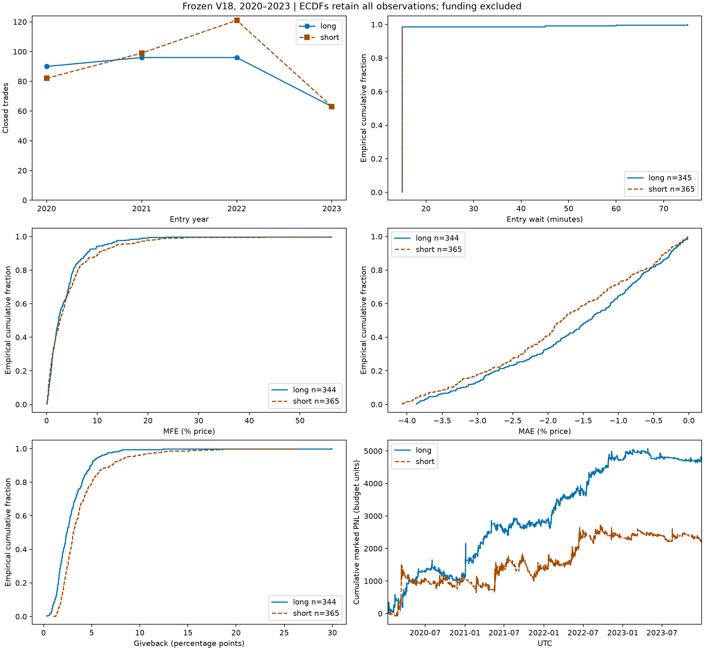
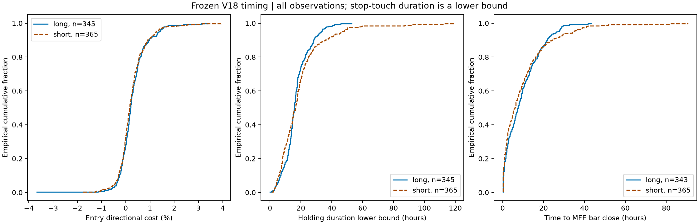
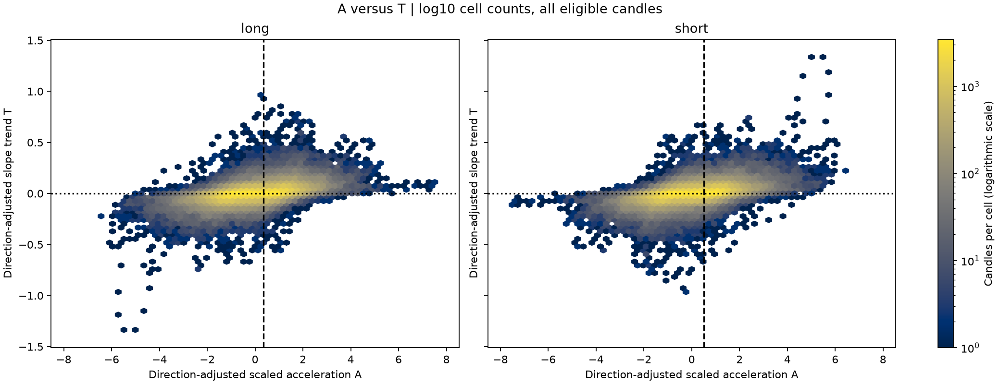

# V18 → V19 Step 1：冻结策略基准诊断（2020—2023）

**统计性质：2020—2022 是核心参数优化与 Ridge 模型训练阶段；2023 是质量模型配方选择阶段的一部分。最终多头 cap0.02、空头 cap0.08 曾使用 2023—2024 数据选择。本报告是冻结策略的历史行为审计，不是独立样本外验证；尤其不能将 2023 结果当成独立样本外证据。** 本次未读取或利用 2024 年及之后的行情、资金费率、指标或交易结果；模型历史选择范围的披露不等于本次使用这些行情。

任务：`V18_C3_001_30_BASELINE_DIAGNOSTIC_2020_2023`。冻结类：`ETH_KalmanMomentum_V18C3_TwoConfirm`，版本：`V18_C3_001_30_20261021`。仅完成 Step 1，未修改 V18、未训练模型、未选择 cap、未优化参数、未实现 V19。

## 数据与执行口径

- 数据源为已登记哈希的 `stage4_trade_attribution/inputs/ohlcv_pre2024.feather`，该文件只含 2020—2023 开盘时间戳；先读取日期列核验无 2024 记录，加载后立即按 `开盘时间 + 15分钟 ≤ 2023-12-31 23:59:59 UTC` 过滤，再计算任何指标。过滤后副本保存在 `inputs/ohlcv_closed_pre2024.feather`。
- 实际纳入 **140255 根**连续、唯一的 15 分钟 K 线：开盘时间从 2020-01-01 00:00 至 2023-12-31 23:30 UTC；最后完整收盘为 2023-12-31 23:45 UTC。23:45 开盘、2024-01-01 00:00 收盘的最后一根被排除，连其开盘价也不用于成交。收盘信号的时间戳统一为实际收盘时间，而非 K 线开盘时间。
- 4 小时 EMA 仅由 16 根完整 15 分钟 K 线组成，按可用收盘时间 backward asof 合并。未使用旧缓存特征；直接从冻结源码 AST 提取原始 `build_features` 函数，三状态 Joseph 递推、q=1e-7、R=0.01、96 根历史标准差、4 根动量与 8 根斜率趋势均保持原样。历史前缀重算验证了指标与质量评分因果一致性。
- 正式绩效起点为您指定的 **2020-01-10 23:45 UTC**。为允许该开盘成交，保留此前两根已收盘 K 线参与两次确认。旧 `stage4_trade_attribution` 曾使用 1000 根预热和每年空仓重启；本次遵循指定统一起点，并对 2020—2023 **连续重放，不在年末平仓或重启仓位**。因此不能把旧研究的交易总数直接当成本次校验目标。上述统计协议差异不是修改冻结交易阈值。
- 月初确认计数重置、单持仓、已卖出 K 线不能开始新确认、正常退出/亏损早退均两根确认、开盘跳空止损优先于计划退出、入场当根固定止损立即生效，全部沿用冻结参考执行器。
- 每笔保证金预算 1000、2 倍杠杆、不复利；数量 `2000/[成交价×1.0005]`，每边手续费 0.05%、滑点 0.02%。这里的“元”是原研究的 USDT 计价预算单位，不作人民币汇率换算。**未计资金费率，未建模强平，未模拟交易所数量与价格精度取整。** 10000 账户资金仅用于保证固定仓位可执行，不是绩效分母。
- 原生 Freqtrade 移植版的市价零滑点结果不是本报告绩效口径。本次先用两个冻结实现做零滑点一致性核验，再在诊断内存命名空间将独立标量核对器的滑点常数设为登记的 0.0002，对原研究成本结果再次逐笔核对；未改动任何冻结文件。
- 逐笔订单索引、方向、退出原因与完整资金曲线两种口径均一致；诊断多空盈亏曲线之和再次与原引擎对账。`verification.csv` 记录 735 项通过检查，包括每笔两根入场确认及结束后源码/模型哈希不变。

## 绩效

净利润按区间内逐根收盘盯市曲线增量统计；交易次数、胜率、PF、平均盈亏按**实际退出所属年**归属，入场次数另列于 CSV。跨年持仓保持连续：逐年盯市收益与该年平仓交易收益可能不同，不能把两者混同。多空分解来自同一单持仓组合的实际成交，不是分别重跑多头与空头策略。

| 区间 | 方向 | 盯市净利润 | 最大回撤金额 | 平仓笔数 | 胜率（比例） | PF | Sharpe | Sortino |
| --- | --- | --- | --- | --- | --- | --- | --- | --- |
| 2020-2023 | long | 4766.5639 | 683.2595 | 345 | 0.4696 | 1.7456 | 1.5859 | 3.4768 |
| 2020-2023 | short | 2187.7855 | 858.6086 | 365 | 0.3945 | 1.2462 | 0.6256 | 1.3390 |
| 2020-2023 | combined | 6954.3495 | 815.5356 | 710 | 0.4310 | 1.4552 | 1.5163 | 3.1545 |
| 2020-2022 | long | 4723.6969 | 683.2595 | 282 | 0.4894 | 1.8681 | 1.8633 | 4.1478 |
| 2020-2022 | short | 2325.6321 | 858.6086 | 302 | 0.4007 | 1.2993 | 0.7861 | 1.7035 |
| 2020-2022 | combined | 7049.3290 | 815.5356 | 584 | 0.4435 | 1.5336 | 1.8179 | 3.8203 |
| 2020 | long | 1119.0455 | 683.2595 | 90 | 0.3889 | 1.6660 | 1.5285 | 3.3874 |
| 2020 | short | 1032.2893 | 751.2790 | 82 | 0.3902 | 1.5502 | 0.9302 | 2.7032 |
| 2020 | combined | 2151.3348 | 754.0565 | 172 | 0.3895 | 1.6049 | 1.6332 | 4.2205 |
| 2021 | long | 1700.8061 | 630.5274 | 96 | 0.5208 | 1.8495 | 1.7110 | 4.0911 |
| 2021 | short | 334.5970 | 832.3904 | 98 | 0.3673 | 1.1198 | 0.3670 | 0.6721 |
| 2021 | combined | 2035.4031 | 815.5356 | 194 | 0.4433 | 1.4102 | 1.5255 | 3.0257 |
| 2022 | long | 1903.8453 | 319.5870 | 96 | 0.5521 | 2.0823 | 2.4079 | 4.8978 |
| 2022 | short | 958.7459 | 488.8629 | 122 | 0.4344 | 1.3248 | 1.0377 | 2.0040 |
| 2022 | combined | 2862.5911 | 454.5050 | 218 | 0.4862 | 1.6129 | 2.3350 | 4.3903 |
| 2023 | long | 42.8671 | 429.8134 | 63 | 0.3810 | 1.0451 | 0.1302 | 0.2230 |
| 2023 | short | -137.8466 | 423.4358 | 63 | 0.3651 | 0.8764 | -0.3765 | -0.6481 |
| 2023 | combined | -94.9795 | 672.6524 | 126 | 0.3730 | 0.9540 | -0.1990 | -0.3392 |

`annual_performance.csv` 同时提供平均盈利/亏损、盈亏比、均值/中位持仓时长、MFE、MAE、回吐、固定 1000 分母回撤百分比与历史资金曲线高点分母回撤百分比。最大回撤为 **15分钟收盘盯市回撤**，不声称是 K 线内极值回撤。Sharpe 使用每天净盈亏/1000 的均值除以样本标准差再乘 √365；Sortino 使用相同均值除以 `sqrt(mean(min(日收益,0)^2))` 再乘 √365，包含空仓日，零无风险利率。它们基于固定保证金日收益，不是复利账户收益。第一年仅从正式起点统计。

月度收益详见 `monthly_performance.csv`（48个月×3方向，共144行）；月收益百分比为当月盯市盈亏/1000×100，不滚动更换分母。2023 组合净利润 **-94.98**，多头 +42.87、空头 -137.85；这只是已参与配方选择历史中的冻结表现。

## 入场延迟

技术信号定义为 M、S、A、T 同时通过；质量通过为冻结 Ridge 评分达到门槛；完整信号为同一根 K 线二者同时通过。逐笔回溯仅限上次退出后可用的空仓 K 线及同一 UTC 月、同一连续技术信号段，不跨持仓拼接“首次信号”。`first_full_signal_time` 为该段首次完整信号；若质量条件中途失败，实际成功确认可能从更晚的 `first_confirmation_time` 重新开始。质量首次通过在该技术段内计算，因此与该段首次完整信号相同，不回溯任意久以前的孤立质量通过。

`D_entry = 100×s×(实际成交价/首次完整信号收盘价−1)`；正值为方向性价格恶化。确认价格成本则从实际成功确认的第一根收盘量到第二根收盘，执行成本从第二根收盘量到实际成交。三项是不同基准的百分比，不能机械相加。

| 方向 | 笔数 | 均值等待分钟 | 中位 | P75 | P90 | 平均D_entry% | 恶化比例 | 改善比例 | 恶化>0.2% | 恶化>0.5% | 恶化>1% |
| --- | --- | --- | --- | --- | --- | --- | --- | --- | --- | --- | --- |
| long | 345 | 15.6087 | 15.0000 | 15.0000 | 15.0000 | 0.2830 | 0.7188 | 0.2812 | 0.5014 | 0.2464 | 0.0899 |
| short | 365 | 15.0000 | 15.0000 | 15.0000 | 15.0000 | 0.2490 | 0.6712 | 0.3288 | 0.4603 | 0.2411 | 0.0877 |

| 方向 | 两次收盘间隔分钟 | 确认价格成本% | 第二次收盘至成交成本% | 技术→完整信号均值分钟 | 技术段内质量等待比例 | 质量等待价格变化% |
| --- | --- | --- | --- | --- | --- | --- |
| long | 15.0000 | 0.2445 | 0.0220 | 4.7826 | 0.2029 | 0.2453 |
| short | 15.0000 | 0.2281 | 0.0210 | 5.5890 | 0.2000 | 0.1411 |

实际两根确认固定增加 **15分钟**收盘等待，多头平均价格延伸 **0.2445%**、空头 **0.2281%**；下一开盘与滑点平均另对应 **0.0220% / 0.0210%**。完整信号到成交平均 **15.61 / 15.00分钟**，多头略长是少量质量通过中断导致确认重启。约四分之一交易 D_entry 超过0.5%，约9%超过1%；存在可观测的等待价格延伸，但改善价格的交易也占28.12%/32.88%。这不是“一根确认一定更优”的因果证据：一根确认会改变样本、后续占仓及亏损风险，本阶段没有做该对照。

技术段内质量条件造成等待的实际成交比例约 **20.29% / 20.00%**，平均技术→完整信号增加 **4.78 / 5.59分钟**。这只描述最终成交者中可追溯的局部延后；被质量完全拒绝、技术中断及仓位占用后的机会没有配对成交，不能据此宣称质量模型的整体净入场成本。

| 年 | 方向 | 笔数 | 平均等待分钟 | 平均D_entry% | 确认价格成本% | 质量等待分钟 |
| --- | --- | --- | --- | --- | --- | --- |
| 2020 | long | 90 | 15.3333 | 0.1786 | 0.1508 | 5.1667 |
| 2020 | short | 82 | 15.0000 | 0.2838 | 0.2598 | 5.3049 |
| 2021 | long | 96 | 15.7812 | 0.3310 | 0.2851 | 4.8438 |
| 2021 | short | 99 | 15.0000 | 0.3112 | 0.2912 | 8.9394 |
| 2022 | long | 96 | 15.6250 | 0.3056 | 0.2586 | 5.1562 |
| 2022 | short | 121 | 15.0000 | 0.2496 | 0.2293 | 3.9669 |
| 2023 | long | 63 | 15.7143 | 0.3243 | 0.2951 | 3.5714 |
| 2023 | short | 63 | 15.0000 | 0.1051 | 0.0853 | 3.8095 |

等待时间差异较小，价格成本随年份变化；需同时看幅度与持仓选择，而不能只看平均等待时长。

## 退出滞后与利润回吐

逐笔区分首次原始斜率反向、正常退出已启用、首次完整正常条件、首次完成连续两根退出确认以及实际下一开盘退出。`normal_exit_enabled_time` 记录首次曾出现方向一致原始斜率、从而 armed 的收盘时刻，可在入场前最后一根收盘（恰等于入场时间）。多头完整正常条件为 armed 后斜率反向；空头始终额外保留 **方向调整动量 < -0.38%**，未把第一次斜率反向当成交。

“从首次反向/完整条件到成交的滞后根数”按该信号实际收盘至退出开盘的时间除15分钟。由于同一边界上前一根收盘与下一根开盘时间相同，最后成功两根确认的第一根收盘到成交为1根间隔，第二根收盘到成交为0根间隔；更大的数值包括先前失败/重置的连续段等待，不是把这些段错误视为持续退出信号。

| 方向 | 退出类别 | 笔数 | 平均MFE% | 平均MAE% | 实际毛收益% | 回吐百分点 | 回吐比中位数 | 平均持仓小时 | 首次斜率反向滞后根 | 首次完整条件滞后根 |
| --- | --- | --- | --- | --- | --- | --- | --- | --- | --- | --- |
| long | all | 345 | 3.6611 | -1.5998 | 0.7915 | 2.8560 | 1.0359 | 16.8478 | NA | NA |
| long | normal | 270 | 4.3453 | -1.2660 | 1.8343 | 2.5110 | 0.7460 | 19.4000 | 1.4778 | 1.4778 |
| long | early_loss | 43 | 1.1658 | -2.7152 | -2.2726 | 3.4384 | 3.6226 | 9.7093 | NA | NA |
| long | fixed_stop | 32 | 1.1636 | -2.9599 | -3.8892 | 5.0528 | 5.1931 | 4.9062 | NA | NA |
| short | all | 365 | 4.3115 | -1.8104 | 0.3996 | 3.9119 | 1.3175 | 19.0479 | NA | NA |
| short | normal | 238 | 5.8896 | -1.2960 | 1.9452 | 3.9445 | 0.7716 | 24.6166 | 27.8151 | 14.2731 |
| short | early_loss | 101 | 1.1615 | -2.6801 | -2.0864 | 3.2478 | 3.7631 | 8.3738 | NA | NA |
| short | fixed_stop | 26 | 2.1021 | -3.1409 | -4.0908 | 6.1929 | 4.3844 | 9.5385 | NA | NA |

正常退出多头270笔、空头238笔。从首次斜率反向至退出多头平均 **1.48根（22.17分钟）**、空头 **27.82根（417.23分钟）**；从首次完整正常退出条件至退出为 **1.48 / 14.27根**。后一项包含正常条件中断、反复与重新累计确认，尤其空头不能归因于单一确认门槛。从首次斜率反向到首次完整条件的差异，是空头额外动量条件与时间路径共同作用的可观测表现，未拆成因果贡献。

MFE 为实际完整持仓 K 线高/低价相对成交入场价的最大有利变动，至少为0；MAE为最大不利变动，负数或0。开盘退出不包含退出当根高低价。固定止损触发当根属于部分持仓 K 线，**58笔止损的触发 K 线高低价均排除**，其 MFE仅是保守下界、MAE也不含已知实际止损成交所对应的完整逆向路径；无完整持仓 K 线时填NA。没有用部分持仓的整根高低价伪造精确 MFE/MAE。止损成交收益单独按真实执行器记录，正常退出和早退的完整持仓 K 线不存在该顺序不确定性。

`time_to_MFE` 是最大浮盈所属 K 线的**收盘时刻**减入场时间，真实高/低出现时刻在该15分钟区间内未知；MFE为0时不假定峰值时间。止损触发时刻仅知在15分钟内，`actual_exit_time` 留空，另列 `exit_bar_open_time` 与精度标签；持仓时长提供该区间下界和上界。正常/早退为精确开盘时间。

毛收益为方向调整价格收益，净收益为扣双边手续费且包含成交滑点后的固定1000保证金收益；二者的分母与杠杆不同，不能直接相减当手续费。`giveback = MFE − 毛收益`（价格百分点），仅MFE>0计算 `giveback_ratio`。亏损交易可超过100%，极小MFE会使均值很大，因此主表使用回吐比中位数；未将负回吐强行裁零。

盈利交易共 **306笔**，其中回吐超过1价格百分点的 **287笔**（多头143/162，空头144/144）；回吐超过MFE一半的 **167笔**（多头73/162，空头94/144）。正常退出平均回吐多头 **2.5110**、空头 **3.9445** 个价格百分点，支持空头更严重的描述；但MFE是事后极值，不能解释为可无风险收割的利润。固定止损与亏损早退也有回吐，不能把全部回吐归罪于正常退出。

“长时间、低收益贡献”预先按描述性口径定义为持仓下界>24小时且单笔净盈亏绝对值<10预算单位（固定保证金1%）；共 **15笔**（多头4、空头11），总净盈亏 **6.12**，详见 `long_hold_low_contribution.csv`。这不是新增交易规则。

| 方向 | 退出类别 | 笔数 | 净盈亏合计 | 平均持仓小时 |
| --- | --- | --- | --- | --- |
| long | early_loss | 43 | -2038.4586 | 9.7093 |
| long | fixed_stop | 32 | -2550.5848 | 4.9062 |
| long | normal | 270 | 9355.6073 | 19.4000 |
| short | early_loss | 101 | -4416.3365 | 8.3738 |
| short | fixed_stop | 26 | -2179.1973 | 9.5385 |
| short | normal | 238 | 8783.3193 | 24.6166 |

## A 与 T 的信息关系

A指策略实际使用的标准化三状态加速度，T为原始斜率最近8根回归趋势。下表对每根合格 K 线分别计算，A阈值多空不同，T阈值始终为方向调整值>0。

| 方向 | K线数 | Pearson | Spearman | 通过标记φ | 仅A通过比例 | 仅T通过比例 | A/T均通过比例 | M/S通过数 | M/S下仅A比例 | M/S下仅T比例 |
| --- | --- | --- | --- | --- | --- | --- | --- | --- | --- | --- |
| long | 139297 | 0.5045 | 0.5250 | 0.3637 | 0.1117 | 0.2094 | 0.2861 | 9286 | 0.1420 | 0.0793 |
| short | 139297 | 0.5045 | 0.5250 | 0.3627 | 0.0953 | 0.2308 | 0.2737 | 7269 | 0.1307 | 0.0758 |

Pearson **0.5045**、Spearman **0.5250** 表明中等相关，不能称为近乎相同的信息。在M、S已通过时，约 **14.20% / 13.07%** K线只过A不过T，约 **7.93% / 7.58%** 只过T不过A，两者依然能排除不同的候选信号。两方向连续值相关相同，是因为两列同时乘-1不会改变相关系数，不是重复抄写。

`condition_combinations.csv` 完整列出16种 M/S/A/T 通过组合（位序固定为M,S,A,T；1111为技术信号），含逐年、多空与质量通过数。`per_bar_conditions.csv.gz` 为每根K线每方向的五项通过标记与确认标记。`signal_forward_returns.csv` 含各组合未来1/2/4/8小时方向价格变化，不能作为交易策略收益，也没有据此删除任何条件。

## 冻结 Ridge 筛选

| 方向 | 技术信号根数 | 质量拒绝根数 | 拒绝比例 | 质量通过根数 | 两根确认信号根数 | 实际成交笔数 |
| --- | --- | --- | --- | --- | --- | --- |
| long | 5701 | 3624 | 0.6357 | 2077 | 1168 | 345 |
| short | 4783 | 1635 | 0.3418 | 3148 | 1988 | 365 |

多头拒绝 **3624/5701（63.57%）**，空头拒绝 **1635/4783（34.18%）**。1168/1988是所有完成连续确认的**信号根数**，同一连续段第三根以后仍可能再发确认信号；并不等于独立交易机会。仓位占用、卖出当根禁止开始确认与月初重置，使最终成交只有345/365；信号漏斗各阶段分母不能混用，也不是每个未成交确认都由模型阻挡。

以下为技术信号中按质量通过/拒绝分组的固定未来价格变化。起点为该已收盘信号的收盘价，终点为之后相应小时的完整K线收盘价；边界不足者排除，不读取2024价格，不加杠杆、不扣成本、不约束单持仓，观测相互重叠。

| 方向 | 分组 | 未来小时 | 信号根数 | 均值价格变化% | 中位数% | 方向盈利比例 |
| --- | --- | --- | --- | --- | --- | --- |
| long | technical_quality_pass | 1 | 2077 | 0.0885 | -0.0251 | 0.4882 |
| long | technical_quality_reject | 1 | 3624 | -0.0062 | -0.0759 | 0.4570 |
| long | technical_quality_pass | 2 | 2077 | 0.1120 | 0.0184 | 0.5094 |
| long | technical_quality_reject | 2 | 3624 | 0.0068 | -0.0785 | 0.4727 |
| long | technical_quality_pass | 4 | 2077 | 0.1486 | 0.0489 | 0.5166 |
| long | technical_quality_reject | 4 | 3624 | 0.0815 | -0.0440 | 0.4851 |
| long | technical_quality_pass | 8 | 2077 | 0.3955 | 0.2802 | 0.5599 |
| long | technical_quality_reject | 8 | 3624 | 0.2490 | 0.1550 | 0.5265 |
| short | technical_quality_pass | 1 | 3148 | -0.0618 | -0.1426 | 0.4266 |
| short | technical_quality_reject | 1 | 1635 | -0.1269 | -0.2044 | 0.4239 |
| short | technical_quality_pass | 2 | 3148 | -0.0753 | -0.1398 | 0.4400 |
| short | technical_quality_reject | 2 | 1635 | -0.2378 | -0.2704 | 0.4031 |
| short | technical_quality_pass | 4 | 3148 | -0.1538 | -0.2342 | 0.4282 |
| short | technical_quality_reject | 4 | 1635 | -0.1821 | -0.3079 | 0.4202 |
| short | technical_quality_pass | 8 | 3148 | -0.0194 | -0.2358 | 0.4492 |
| short | technical_quality_reject | 8 | 1635 | -0.1914 | -0.3509 | 0.4324 |

通过信号在两方向、四个期限的均值均高于拒绝信号，是**描述性的筛选改善迹象**。但多头通过组1小时中位数仍为负；空头通过组四个期限均值都为负，说明“比拒绝组好”不等于本身存在正的短期方向收益。

| 年 | 方向 | 8小时信号分组 | 根数 | 均值价格变化% |
| --- | --- | --- | --- | --- |
| 2020 | long | technical_quality_pass | 492 | 0.6789 |
| 2020 | long | technical_quality_reject | 998 | 0.3299 |
| 2021 | long | technical_quality_pass | 561 | 0.3783 |
| 2021 | long | technical_quality_reject | 1529 | 0.3792 |
| 2022 | long | technical_quality_pass | 650 | 0.2151 |
| 2022 | long | technical_quality_reject | 679 | -0.0283 |
| 2023 | long | technical_quality_pass | 374 | 0.3623 |
| 2023 | long | technical_quality_reject | 418 | 0.0300 |
| 2020 | short | technical_quality_pass | 776 | 0.0075 |
| 2020 | short | technical_quality_reject | 443 | -0.4501 |
| 2021 | short | technical_quality_pass | 940 | -0.1071 |
| 2021 | short | technical_quality_reject | 806 | -0.1038 |
| 2022 | short | technical_quality_pass | 1070 | 0.0703 |
| 2022 | short | technical_quality_reject | 246 | -0.1040 |
| 2023 | short | technical_quality_pass | 362 | -0.1148 |
| 2023 | short | technical_quality_reject | 140 | -0.0307 |

上述差异并非每年都一致；没有对时间依赖作独立样本假设，也未给出不适用的逐根IID显著性检验。**不能证明质量模型提高了真实组合净收益**：历史训练/选择污染、重叠信号、不同年份/波动状态构成、后续单持仓路径均可能影响差异。本阶段未模拟完整影子交易，因而没有伪称被拒绝交易的真实退出或账户收益，也没有将影子收益加到组合中。需要下一轮独立受控、保持原退出与账户约束的比较才能判断模型的净策略增益。

## 年末截断与缺失值

2023年末 `censored/open` 数量为 **0**；本次710笔均在截止前平仓，最后一笔于2023-12-30 16:00 UTC开盘退出。`censored_open_trades.csv` 保留字段、无数据行。未强制年末平仓，若引擎到数据末尾仍持仓，会保留 open 状态，只按最后完整收盘盯市，不填最终退出、毛/净已实现收益、回吐或回吐比；模型/信号不足未来期限者不生成该标签。数据过滤也保证2024成交不可能被本次重放执行。

注意“止损触发 K 线内精确退出时刻未知”与“年末未平仓”是不同缺失原因：前者仍是已平仓交易，后者才是 censored。CSV以状态和精度字段区分，缺失值写为空，绝不按0补齐。

## 图表

图1：ECDF保留全部观测，不截尾、不隐藏离群值；多空同时用颜色与线型区分。MFE/MAE及回吐采用上述完整持仓K线口径；源表为逐笔诊断与逐根资金曲线。

图2：多空入场价格成本、持仓时长下界与MFE所在K线收盘时间的经验累积分布。NA不转成0，图例列出各变量有效样本数。

图3：全部合格K线的A/T六边形密度，色阶为每格计数的log10映射，虚线/点线为冻结A阈值/T阈值；两方向使用各自原始阈值。内部研究图，PNG 160 DPI，不作期刊规范认证。

## Q1—Q7 与证据等级

1. **Q1，是否明显延迟？已证明存在一根15分钟的结构等待和价格成本。** 多/空平均D_entry为0.2830%/0.2490%，约24%交易超过0.5%。这是否“过度”尚未证明，必须与减少确认的完整风险收益路径比较。
2. **Q2，两根确认成本？已测得15分钟，平均确认期间价格延伸0.2445%/0.2281%。** 这些是成功成交者上的可观测成本，不是直接少赚的账户收益；无法从本阶段算出改为一根后的净策略收益。
3. **Q3，A/T是否明显冗余？只有部分相关，没有证明高度冗余。** 相关约0.50，M/S通过候选中两个条件分别拒绝的集合仍明显不同；删任一项是否可行须下一轮对照，本阶段不删除。
4. **Q4，质量筛掉多少、有效吗？拒绝多头63.57%、空头34.18%的技术信号根数。** 通过组未来均值整体较好，有筛选迹象，但没有证明真实组合净收益增益；空头通过信号的短期均值仍为负，且逐年不稳定。
5. **Q5，退出是否造成回吐？已测得大量实现前回吐，但因果归因未完成。** 正常退出平均回吐2.5110/3.9445个百分点；287/306笔盈利交易回吐>1个百分点。回吐本身真实，不能把事后MFE等同于可实现成交收益，也不能将止损与早退回吐全归给正常退出。
6. **Q6，多空结构不同？已证明行为差异。** 空头正常退出首次斜率反向滞后27.82根而多头1.48根；空头亏损早退101笔而多头43笔，PF为1.246而多头1.746，正常回吐更大。原因分解与改进有效性仍是待验证命题。
7. **Q7，下一阶段若仅改一个因素，优先研究空头正常退出的0.38%动量附加资格条件。** 理由是空头相较多头极大的首次反向→退出滞后及正常回吐，而入场确认成本两方向接近。建议仅把该条件作为单因素对照对象，保留其余确认、风险、质量模型、成本与单持仓约束；先预登记对照，再检查净收益、止损、回撤和交易路径变化。**这只是下一轮研究优先级，不是已证明应删除该条件，不启动实验、不选择替代阈值。**

## 文件、复现与交付

核心文件为任务要求的8项，另附原始过滤行情、冻结源码与模型只读副本、逐根标记、条件组合、信号级未来变化、验证表、图表、运行日志、低贡献长持仓清单。主命令：`python run_audit.py`；报告命令：`python build_report.py`。依赖为numpy/pandas/pyarrow/matplotlib，必要时读取工作区 `.research_deps`。本地原始路径和哈希写在 `diagnostic_metadata.json`。

原工作区未初始化Git，因此在本研究目录建立独立Git仓库及研究分支，避免把其他研究或冻结策略纳入提交；分支与提交信息写入 `git_delivery.txt`（提交后生成的凭证，不纳入自身哈希循环）。只提交本次诊断内容，不推送或发布。运行第一版时的诊断时区比较错误已修复，失败日志保留为 `run_attempt1.log`；最终以成功的 `run.log` 为准。

Step 1 到此结束，等待研究负责人审阅。未进入 Step 2。
