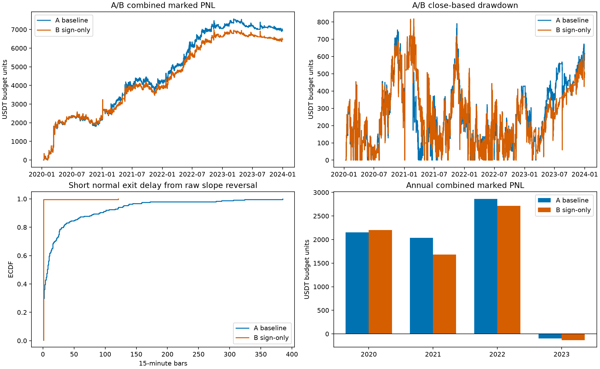
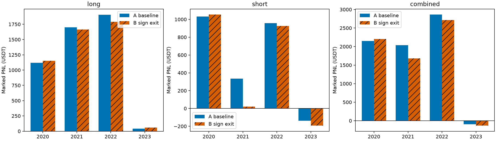

# V19 Step 2：空头正常退出动量资格条件单因素消融

**2020—2022 为核心参数优化和质量模型训练阶段；2023 参与质量模型配方选择，最终 cap 配方历史选择用过2023—2024。此次2020—2023 A/B 是回顾性单因素研究，不是独立样本外证据。未读取任何2024年及之后行情、指标、资金费率或交易结果。**

## 实验和基准门禁

A 完整冻结 V18，B 仅在实验月度计划把空头 `exit_kind=momentum` 改成 `sign`。**原记录 `exit_value=0.38` 保留**。空头由 `s*slope<0 AND s*momentum4<-0.38` 改为 `s*slope<0`，armed、两根连续15分钟收盘确认、下一根开盘成交全部保留。多头逻辑、入场M/S/A/T、质量模型权重门槛、止损、亏损早退、单持仓、月度调度及执行顺序均不改变。没有修改原始策略或 `selected_models_30.json`，没有参数搜索、训练、部署或 Step 3。

只使用 Step1 已验证 `inputs/ohlcv_closed_pre2024.feather` 的逐字节副本，140255根完整15分钟K线，开盘范围2020-01-01 00:00至2023-12-31 23:30 UTC，最后收盘23:45 UTC，正式绩效起点2020-01-10 23:45 UTC。原三状态指标从2020起连续递推，不做年度空仓重启，不强制平仓。

每笔1000 USDT保证金预算、2倍杠杆、不复利，数量2000/[入场成交价×1.0005]，每边手续费0.05%、滑点0.02%，不含资金费率、不建模强平和交易所精度。开盘跳空止损优先，入场当根止损生效。

**A 先完成 Step1 逐笔入场、退出、方向、退出原因及全部多空资金曲线对账，710笔平仓、整体6954.3495 USDT、2023为-94.9795 USDT均通过，才启动B。** `run.log` 保存门禁通过消息。B 从头重放完整连续组合，没有在A原710笔上改退出。A/B均分别通过独立标量执行器在零滑点与原始成本下的订单序列、资金曲线断言。

## 组合与方向绩效（Δ=B−A）

| direction | A_net_profit_marked | B_net_profit_marked | B_minus_A_net_profit_marked | A_max_drawdown_currency | B_max_drawdown_currency | B_minus_A_max_drawdown_currency | A_trades_closed | B_trades_closed |
| --- | --- | --- | --- | --- | --- | --- | --- | --- |
| long | 4766.5639 | 4664.5734 | -101.9905 | 683.2595 | 648.0456 | -35.2139 | 345 | 365 |
| short | 2187.7855 | 1804.9258 | -382.8597 | 858.6086 | 1059.7601 | 201.1515 | 365 | 383 |
| combined | 6954.3495 | 6469.4992 | -484.8502 | 815.5356 | 817.6198 | 2.0842 | 710 | 748 |

| direction | A_profit_factor | B_profit_factor | A_sharpe | B_sharpe | A_sortino | B_sortino | A_win_rate | B_win_rate | A_mean_win | B_mean_win | A_mean_loss | B_mean_loss |
| --- | --- | --- | --- | --- | --- | --- | --- | --- | --- | --- | --- | --- |
| long | 1.7456 | 1.6713 | 1.5859 | 1.5129 | 3.4768 | 3.2774 | 0.4696 | 0.4685 | 68.8851 | 67.9102 | -34.9335 | -35.8148 |
| short | 1.2462 | 1.2138 | 0.6256 | 0.5434 | 1.3390 | 1.1703 | 0.3945 | 0.4125 | 76.9007 | 64.8506 | -40.2078 | -37.5177 |
| combined | 1.4552 | 1.4204 | 1.5163 | 1.4367 | 3.1545 | 2.9676 | 0.4310 | 0.4398 | 72.6572 | 66.4409 | -37.8187 | -36.7292 |

| direction | A_mean_holding_hours | B_mean_holding_hours | A_median_holding_hours | B_median_holding_hours | A_mean_MFE_pct | B_mean_MFE_pct | A_mean_MAE_pct | B_mean_MAE_pct | A_mean_giveback_pct | B_mean_giveback_pct |
| --- | --- | --- | --- | --- | --- | --- | --- | --- | --- | --- |
| long | 16.8478 | 16.6212 | 15.7500 | 15.5000 | 3.6611 | 3.5919 | -1.5998 | -1.6077 | 2.8560 | 2.8396 |
| short | 19.0479 | 14.4243 | 16.5000 | 13.7500 | 4.3115 | 3.9335 | -1.8104 | -1.7230 | 3.9119 | 3.5979 |
| combined | 17.9789 | 15.4963 | 16.0000 | 14.7500 | 3.9959 | 3.7671 | -1.7082 | -1.6668 | 3.3995 | 3.2284 |

全部指标的显式B−A差值都在 `comparison_period_direction.csv`。最大回撤为15分钟收盘盯市回撤金额，另提供相对固定1000保证金百分比；非盘中极值回撤。Sharpe为日盈亏/1000的均值/样本标准差×√365；Sortino分母为sqrt(mean(min(日收益,0)^2))，含空仓日、零无风险利率。按原Step1固定保证金口径，不是复利账户收益。

多空分解来自同一连续单持仓组合，B提前释放仓位后可能改变后续多头和空头机会，因此多头**规则相同不意味着成交相同**。年度净利润为盯市曲线增量，交易计数和胜率按退出年归属；跨年仍保持持仓。月度固定1000分母收益、48个月×3方向及B−A详见 `monthly_comparison.csv`。

## 空头退出延迟

| variant | n | mean_raw_delay_bars | median_raw_delay_bars | mean_full_delay_bars | median_full_delay_bars | mean_hold_hours | median_hold_hours | mean_MFE_pct | mean_MAE_pct | mean_giveback_pct | normal_net_pnl | B_minus_A_mean_raw_delay_bars |
| --- | --- | --- | --- | --- | --- | --- | --- | --- | --- | --- | --- | --- |
| A | 238 | 27.8151 | 7.0000 | 14.2731 | 1.0000 | 24.6166 | 20.0000 | 5.8896 | -1.2960 | 3.9445 | 8783.3193 | NA |
| B | 263 | 1.4563 | 1.0000 | 1.4563 | 1.0000 | 17.6473 | 16.2500 | 5.0581 | -1.2333 | 3.4119 | 8132.9666 | -26.3589 |

两个版本按各自实际规则重算完整正常退出信号。首次反向→退出均值减少 **26.3589根15分钟K线**（395.3828分钟）；这是不同真实成交样本的分布差异，不能解释为同一批交易逐笔平均提前量。共入场匹配空头 **365笔**，其实际退出平均提前 **18.4384根**、中位 **0.0000根**；匹配表 `matched_entry_comparison.csv` 仅描述共有真实入场，不把其收益当独立策略。

“首次完整条件”时间可能早于最终成功确认段，期间资格失效会重置确认。`short_exit_timing_details.csv` 区分首次完成确认时间与最终成功确认时间。最终第二次确认收盘与实际下一根开盘时间戳相同，**确认后成交等待为0分钟时间间隔**（执行位点仍是下一根开盘，并非当前根收盘成交；实际成交价含下一开盘价格与滑点）。没有改为一根确认。正常退出交易的持仓均值/中位数随样本变化一并列出。

## 退出类别和回吐

| variant | direction | exit_group | n | net_pnl | mean_hold_hours | mean_MFE_pct | mean_MAE_pct | mean_giveback_pct |
| --- | --- | --- | --- | --- | --- | --- | --- | --- |
| A | long | early_loss | 43 | -2038.4586 | 9.7093 | 1.1658 | -2.7152 | 3.4384 |
| A | long | fixed_stop | 32 | -2550.5848 | 4.9062 | 1.1636 | -2.9599 | 5.0528 |
| A | long | normal | 270 | 9355.6073 | 19.4000 | 4.3453 | -1.2660 | 2.5110 |
| A | short | early_loss | 101 | -4416.3365 | 8.3738 | 1.1615 | -2.6801 | 3.2478 |
| A | short | fixed_stop | 26 | -2179.1973 | 9.5385 | 2.1021 | -3.1409 | 6.1929 |
| A | short | normal | 238 | 8783.3193 | 24.6166 | 5.8896 | -1.2960 | 3.9445 |
| B | long | early_loss | 44 | -2083.6205 | 9.5795 | 1.1894 | -2.7369 | 3.4594 |
| B | long | fixed_stop | 37 | -2949.1137 | 4.7770 | 1.1654 | -2.9983 | 5.0546 |
| B | long | normal | 284 | 9697.3076 | 19.2553 | 4.2718 | -1.2564 | 2.4627 |
| B | short | early_loss | 94 | -4148.8435 | 7.9840 | 1.2162 | -2.6968 | 3.3231 |
| B | short | fixed_stop | 26 | -2179.1973 | 5.1058 | 2.3823 | -3.1550 | 6.4731 |
| B | short | normal | 263 | 8132.9666 | 17.6473 | 5.0581 | -1.2333 | 3.4119 |

MFE/MAE只用真实持仓期间的完整K线；开盘退出不取退出当根高低价，止损触发当根为部分持仓、其高低价均排除；因此止损MFE是保守下界，MAE不包含部分触发K线，若无完整持仓K线则NA。毛收益按方向调整成交价变化，净收益按保证金分母含杠杆和双边成本；giveback=MFE−实际毛收益，仅MFE>0定义回吐比。事后最大浮盈不等于可无风险兑现利润；退出更快也不必然收益更好。

## 年度稳定性

| period | direction | A_net_profit_marked | B_net_profit_marked | B_minus_A_net_profit_marked | A_max_drawdown_currency | B_max_drawdown_currency | B_minus_A_max_drawdown_currency |
| --- | --- | --- | --- | --- | --- | --- | --- |
| 2020-2023 | long | 4766.5639 | 4664.5734 | -101.9905 | 683.2595 | 648.0456 | -35.2139 |
| 2020-2023 | short | 2187.7855 | 1804.9258 | -382.8597 | 858.6086 | 1059.7601 | 201.1515 |
| 2020-2023 | combined | 6954.3495 | 6469.4992 | -484.8502 | 815.5356 | 817.6198 | 2.0842 |
| 2020-2022 | long | 4723.6969 | 4604.4270 | -119.2698 | 683.2595 | 648.0456 | -35.2139 |
| 2020-2022 | short | 2325.6321 | 1998.0731 | -327.5591 | 858.6086 | 1059.7601 | 201.1515 |
| 2020-2022 | combined | 7049.3290 | 6602.5001 | -446.8289 | 815.5356 | 817.6198 | 2.0842 |
| 2020 | long | 1119.0455 | 1150.3818 | 31.3363 | 683.2595 | 648.0456 | -35.2139 |
| 2020 | short | 1032.2893 | 1053.7643 | 21.4750 | 751.2790 | 665.4180 | -85.8611 |
| 2020 | combined | 2151.3348 | 2204.1460 | 52.8113 | 754.0565 | 696.5069 | -57.5496 |
| 2021 | long | 1700.8061 | 1663.6544 | -37.1517 | 630.5274 | 630.5274 | 0.0000 |
| 2021 | short | 334.5970 | 19.8711 | -314.7259 | 832.3904 | 775.3296 | -57.0608 |
| 2021 | combined | 2035.4031 | 1683.5255 | -351.8776 | 815.5356 | 817.6198 | 2.0842 |
| 2022 | long | 1903.8453 | 1790.3909 | -113.4544 | 319.5870 | 375.8816 | 56.2946 |
| 2022 | short | 958.7459 | 924.4377 | -34.3081 | 488.8629 | 601.3149 | 112.4520 |
| 2022 | combined | 2862.5911 | 2714.8286 | -147.7626 | 454.5050 | 531.3772 | 76.8722 |
| 2023 | long | 42.8671 | 60.1464 | 17.2793 | 429.8134 | 426.7757 | -3.0377 |
| 2023 | short | -137.8466 | -193.1473 | -55.3007 | 423.4358 | 488.0758 | 64.6400 |
| 2023 | combined | -94.9795 | -133.0009 | -38.0213 | 672.6524 | 616.1037 | -56.5488 |

组合在4个单年中 **1年** 净利润改善，不能用总和掩盖年度恶化。48个月中组合 **24个月**改善、**23个月**恶化、其余相同。2023仍非独立样本外，不据本次结果调阈值。

## Q1—Q7 与结论

1. Q1：首次反向至正常退出平均延迟从A的27.8151降至B的1.4563根，样本平均减少26.3589根；共有空头入场的实际退出提前均值另见上文，不混淆两个估计量。
2. Q2：空头净利润B−A为 **-382.8597 USDT**。完整组合回放已计入额外/消失入场，不能仅凭持仓变短判断获利增加。
3. Q3：空头正常退出 **238→263（+25）**、亏损早退 **101→94（−7）**、固定止损 **26→26（0）**。没有增加空头止损或早退次数，但正常退出净利润由8783.32降至8132.97 USDT。多头固定止损32→37（+5）、早退43→44（+1），表明组合占仓路径变化也影响多头风险。规则本身均未修改。
4. Q4：组合净利润B−A为 **-484.8502 USDT**（约-6.97%）；多头345→365笔，净利润4766.56→4664.57（−101.99）；空头365→383笔，净利润2187.79→1804.93（−382.86）。共有317笔多头入场的实际退出完全相同，差额来自入场机会集合改变；非多头退出规则变更。
5. Q5：组合最大回撤815.5356→817.6198 USDT，B−A为 **2.0842 USDT**，小幅恶化，并无改善。空头分解回撤858.61→1059.76（+201.15，约23.43%）恶化更明显；多头分解回撤683.26→648.05改善。分解回撤不是可以简单相加的组合回撤。
6. Q6：4个单年中1年组合净利润改善，逐年及逐方向差值在年度表完整披露；仅为历史稳定性描述。
7. Q7：**B 没有明显优势，保留 A**。退出确实更快、正常退出平均回吐由3.9445降至3.4119价格百分点，但空头净利润减少、组合净利润减少且组合回撤未改善，4年仅2020组合收益改善，当前缺乏将B作为优先候选的充分证据。更低的回吐还同时伴随更低的平均MFE，不能将二者差异直接当成获利改善。这是历史研究取舍，尚无独立样本外或前瞻验证，不升级、不部署B；不证明普遍最优或未来收益。

图表保留所有观测，不截尾。两个版本均以同一价格和成本输入计算；图中ECDF为各版本实际空头正常退出样本，非固定交易集。独立复现命令为 `python run_step2.py`、`python build_step2_report.py`。冻结研究的Step1结果不修改；独立目录和分支保存所有实验输出。

**Step 2 到此停止，等待研究负责人审阅；未进入Step 3。**
