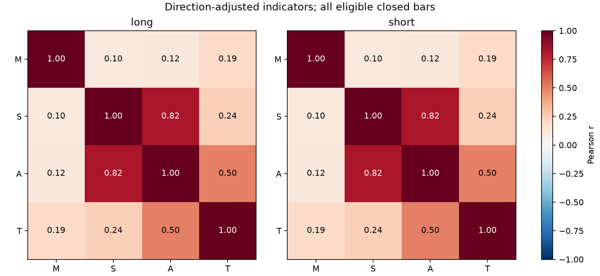
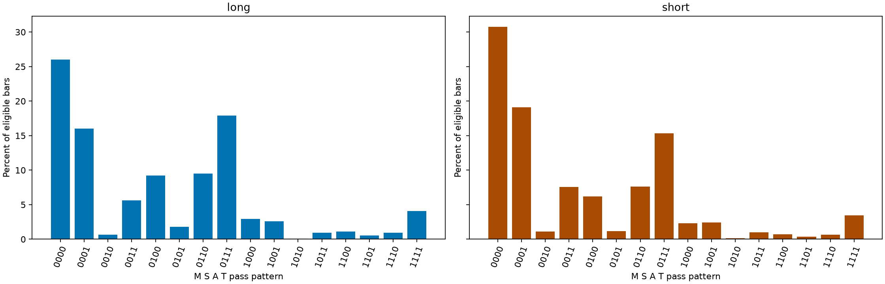
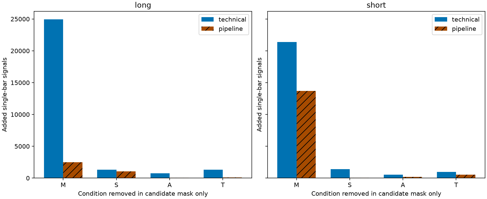
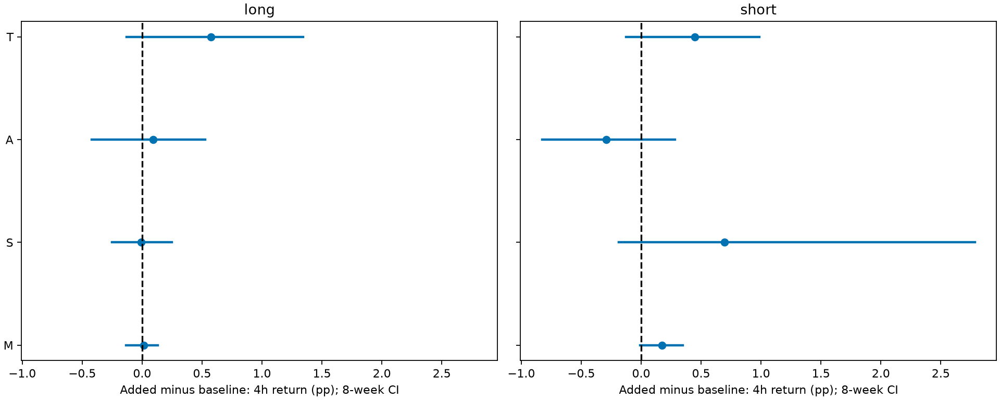
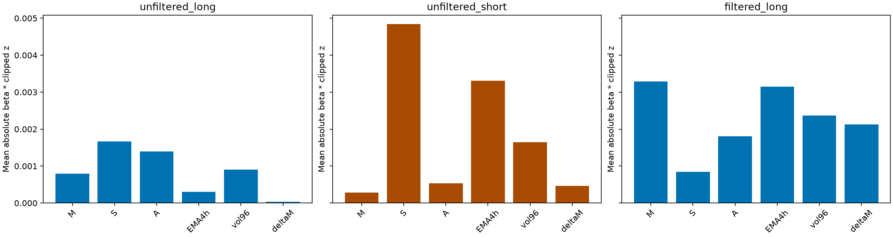
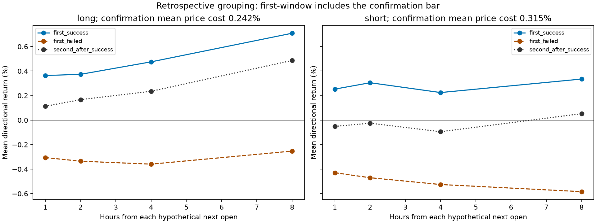
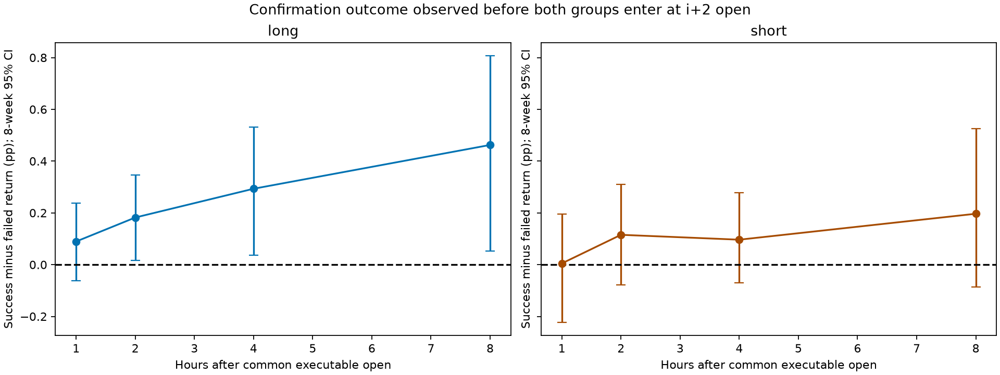

# V19 Step 3：入场条件冗余与独立信息贡献审计

任务编号：`V19_STEP3_ENTRY_REDUNDANCY_AUDIT_2020_2023`。

**本次全部结论属于探索性的历史样本内机制诊断。2020—2022 已用于参数优化和模型训练，2023参与配方选择；最终cap配方历史上使用过2023—2024选择。2023不是独立样本外。本次没有读取2024年及以后任何行情、指标、资金曲线或交易结果。Bootstrap不能消除参数搜索偏差或多重比较选择偏差。**

## 范围与冻结

从 Step2 `c2cedb8524ebc7c6574c03d41cb0decdbaf086a5` 建立独立分支；只新增本目录，Step1和Step2已提交文件保持不变。此前未提交的退出稳健性目录保留在工作区且不纳入本研究或提交。未修改V18、任何阈值、模型、确认、退出、早退或止损；没有训练、优化或完整策略消融回测。

复用Step1 `run_audit.original_features` 与 `get_signals`，直接从冻结源码提取原指标函数。先按日期列核对数据边界，再加载已验证 `inputs/ohlcv_closed_pre2024.feather` 并立即截断，之后计算指标。原始140255根15分钟完整K线，开盘范围2020-01-01 00:00至2023-12-31 23:30 UTC，最后收盘23:45 UTC；正式信号统计起点2020-01-10 23:45 UTC，139297根有效M/S/A/T记录。4小时EMA按16根完整15分钟K线聚合，以已完成4小时收盘时间向后匹配；指标和评分通过历史前缀重算核验。

正式起点首根的4小时EMA尚未达到原始60根最小历史，评分按冻结 `nan_to_num` 将缺失标准化特征置0，未补未来信息。相关性、偏相关性按各分析所需特征完整样本计算，有效n单列。M=4根动量，S=原始三状态斜率/此前96根标准差，A=同法标准化加速度，T=最近8根原始斜率回归趋势；均乘方向s。阈值多头0.69/0.21/0.340/0，空头0.76/0.49/0.505/0，全部严格大于。Ridge维持原门槛、均值、尺度和±5截断。

信号级诊断不受实际仓位占用限制，不加杠杆，不扣手续费/滑点；不是1000USDT账户收益，也不累加重叠信号。**信号i收盘后，以第i+1根开盘作为假设入场；h小时终点为i+4h根收盘，MFE/MAE使用i+1至i+4h完整K线高低价。** 截止不足的标签为NA，各表披露有效n和排除数；绝不取信号当前收盘冒充成交。

## M/S/A/T相关性与通过集合

| direction | feature_1 | feature_2 | n | correlation | partial_correlation |
| --- | --- | --- | --- | --- | --- |
| long | M | S | 139297 | 0.1030 | 0.0743 |
| long | M | A | 139297 | 0.1156 | -0.0493 |
| long | M | T | 139297 | 0.1916 | 0.1712 |
| long | S | A | 139297 | 0.8170 | 0.8308 |
| long | S | T | 139297 | 0.2394 | -0.3536 |
| long | A | T | 139297 | 0.5045 | 0.5513 |
| short | M | S | 139297 | 0.1030 | 0.0743 |
| short | M | A | 139297 | 0.1156 | -0.0493 |
| short | M | T | 139297 | 0.1916 | 0.1712 |
| short | S | A | 139297 | 0.8170 | 0.8308 |
| short | S | T | 139297 | 0.2394 | -0.3536 |
| short | A | T | 139297 | 0.5045 | 0.5513 |

上表偏相关控制其余两项指标。CSV还提供Spearman及秩偏相关、逐年逐季度，以及M/S已通过、四项全通过、对每项控制其余三项已通过的条件样本相关。季度只是日历分组，不是重新选择市场阈值；另列冻结4小时EMA上/下环境。条件筛选本身会造成范围限制与碰撞偏差，不把条件相关当因果独立性。

| direction | event | condition | condition_n | conditional_probability | unconditional_pass_rate |
| --- | --- | --- | --- | --- | --- |
| long | M | S | 62763 | 0.1480 | 0.1324 |
| long | S | M | 18449 | 0.5033 | 0.4506 |
| long | A | T | 69023 | 0.5774 | 0.3978 |
| long | T | A | 55411 | 0.7192 | 0.4955 |
| short | M | S | 49564 | 0.1467 | 0.1108 |
| short | S | M | 15433 | 0.4710 | 0.3558 |
| short | A | T | 70274 | 0.5425 | 0.3690 |
| short | T | A | 51400 | 0.7417 | 0.5045 |

`indicator_pass_patterns.csv` 列出所有16组合（固定M,S,A,T位序，含数量和比例），直接涵盖两两共通过、三项通过另一项拒绝及四项全通过；`indicator_conditional_pass.csv` 列出全部有序条件概率及单项通过/拒绝比例。对角event=condition的概率1只用于核对，不作信息价值证据。

## 单项条件边际贡献

technical层仅删除技术掩码的一项：其余三项通过且该项失败；pipeline层将同一批新增单根候选再经过**原封不动的Ridge**。M/S/A依然留在质量模型特征中，所以pipeline测量显式门槛在当前流水线内的边际作用，不代表移除整个信息源。这里只构建诊断掩码，不删除真实条件、不运行策略。

| direction | removed_condition | layer | original_signal_bars | added_signal_bars | ridge_rejected_added | new_confirmed_candidate_bars |
| --- | --- | --- | --- | --- | --- | --- |
| long | M | technical | 5701 | 24956 | 22475 | 2156 |
| long | M | pipeline | 2077 | 2481 | 22475 | 2156 |
| long | S | technical | 5701 | 1336 | 269 | 613 |
| long | S | pipeline | 2077 | 1067 | 269 | 613 |
| long | A | technical | 5701 | 736 | 694 | 25 |
| long | A | pipeline | 2077 | 42 | 694 | 25 |
| long | T | technical | 5701 | 1319 | 1230 | 39 |
| long | T | pipeline | 2077 | 89 | 1230 | 39 |
| short | M | technical | 4783 | 21378 | 7687 | 13775 |
| short | M | pipeline | 3148 | 13691 | 7687 | 13775 |
| short | S | technical | 4783 | 1419 | 1379 | 24 |
| short | S | pipeline | 3148 | 40 | 1379 | 24 |
| short | A | technical | 4783 | 551 | 360 | 119 |
| short | A | pipeline | 3148 | 191 | 360 | 119 |
| short | T | technical | 4783 | 950 | 428 | 318 |
| short | T | pipeline | 3148 | 522 | 428 | 318 |

`new_confirmed_candidate_bars` 额外提供保留月初重置和两根确认后相对于原流水线新增的信号K线数量（不是交易笔数，可为现根本已全通过而前根新增引发）。该字段不使用实际单持仓约束，不能称为最终新增成交。单根新增的年度、季度分布及指标均值/中位数/P10/P90见 `marginal_signal_counts.csv` 和 `marginal_feature_distributions.csv`。

以下主表为4小时价格收益的“新增−基准”差异；完整1/2/4/8小时收益、MFE、MAE及正方向比例见 `marginal_signal_outcomes.csv`，Bootstrap文件覆盖全部四期限三项诊断。负差异表示新纳入信号在这个历史均值上较差。

| direction | comparison | block_weeks | n_group1 | n_group0 | mean_group1 | mean_group0 | mean_difference | ci95_low | ci95_high | yearly_same_sign_as_overall |
| --- | --- | --- | --- | --- | --- | --- | --- | --- | --- | --- |
| long | technical_remove_M_minus_baseline | 4 | 24956 | 5701 | 0.0939 | 0.1040 | -0.0101 | -0.0848 | 0.0651 | 3 |
| long | technical_remove_S_minus_baseline | 4 | 1336 | 5701 | 0.1235 | 0.1040 | 0.0194 | -0.2547 | 0.3007 | 3 |
| long | technical_remove_A_minus_baseline | 4 | 736 | 5701 | -0.0682 | 0.1040 | -0.1722 | -0.4314 | 0.0808 | 3 |
| long | technical_remove_T_minus_baseline | 4 | 1319 | 5701 | 0.2575 | 0.1040 | 0.1534 | -0.1468 | 0.4665 | 4 |
| long | pipeline_remove_M_minus_baseline | 4 | 2481 | 2077 | 0.1613 | 0.1470 | 0.0144 | -0.1361 | 0.1381 | 2 |
| long | pipeline_remove_S_minus_baseline | 4 | 1067 | 2077 | 0.1389 | 0.1470 | -0.0081 | -0.2741 | 0.2688 | 2 |
| long | pipeline_remove_A_minus_baseline | 4 | 42 | 2077 | 0.2386 | 0.1470 | 0.0916 | -0.4618 | 0.5710 | 3 |
| long | pipeline_remove_T_minus_baseline | 4 | 89 | 2077 | 0.7191 | 0.1470 | 0.5721 | -0.1341 | 1.3255 | 3 |
| short | technical_remove_M_minus_baseline | 4 | 21366 | 4783 | 0.0171 | -0.1643 | 0.1813 | 0.0551 | 0.2980 | 3 |
| short | technical_remove_S_minus_baseline | 4 | 1419 | 4783 | -0.1469 | -0.1643 | 0.0173 | -0.2497 | 0.2659 | 1 |
| short | technical_remove_A_minus_baseline | 4 | 551 | 4783 | -0.3611 | -0.1643 | -0.1969 | -0.8118 | 0.3114 | 2 |
| short | technical_remove_T_minus_baseline | 4 | 950 | 4783 | 0.2027 | -0.1643 | 0.3670 | -0.0412 | 0.8121 | 3 |
| short | pipeline_remove_M_minus_baseline | 4 | 13682 | 3148 | 0.0200 | -0.1545 | 0.1745 | 0.0007 | 0.3383 | 3 |
| short | pipeline_remove_S_minus_baseline | 4 | 40 | 3148 | 0.5404 | -0.1545 | 0.6949 | -0.2061 | 2.6678 | 2 |
| short | pipeline_remove_A_minus_baseline | 4 | 191 | 3148 | -0.4451 | -0.1545 | -0.2906 | -0.8451 | 0.2955 | 3 |
| short | pipeline_remove_T_minus_baseline | 4 | 522 | 3148 | 0.2933 | -0.1545 | 0.4478 | -0.1125 | 1.0269 | 2 |
| long | technical_remove_M_minus_baseline | 8 | 24956 | 5701 | 0.0939 | 0.1040 | -0.0101 | -0.0758 | 0.0533 | 3 |
| long | technical_remove_S_minus_baseline | 8 | 1336 | 5701 | 0.1235 | 0.1040 | 0.0194 | -0.2526 | 0.2917 | 3 |
| long | technical_remove_A_minus_baseline | 8 | 736 | 5701 | -0.0682 | 0.1040 | -0.1722 | -0.4115 | 0.0775 | 3 |
| long | technical_remove_T_minus_baseline | 8 | 1319 | 5701 | 0.2575 | 0.1040 | 0.1534 | -0.1146 | 0.4417 | 4 |
| long | pipeline_remove_M_minus_baseline | 8 | 2481 | 2077 | 0.1613 | 0.1470 | 0.0144 | -0.1339 | 0.1319 | 2 |
| long | pipeline_remove_S_minus_baseline | 8 | 1067 | 2077 | 0.1389 | 0.1470 | -0.0081 | -0.2500 | 0.2482 | 2 |
| long | pipeline_remove_A_minus_baseline | 8 | 42 | 2077 | 0.2386 | 0.1470 | 0.0916 | -0.4192 | 0.5262 | 3 |
| long | pipeline_remove_T_minus_baseline | 8 | 89 | 2077 | 0.7191 | 0.1470 | 0.5721 | -0.1299 | 1.3412 | 3 |
| short | technical_remove_M_minus_baseline | 8 | 21366 | 4783 | 0.0171 | -0.1643 | 0.1813 | 0.0498 | 0.3030 | 3 |
| short | technical_remove_S_minus_baseline | 8 | 1419 | 4783 | -0.1469 | -0.1643 | 0.0173 | -0.2700 | 0.2680 | 1 |
| short | technical_remove_A_minus_baseline | 8 | 551 | 4783 | -0.3611 | -0.1643 | -0.1969 | -0.8166 | 0.2948 | 2 |
| short | technical_remove_T_minus_baseline | 8 | 950 | 4783 | 0.2027 | -0.1643 | 0.3670 | -0.0402 | 0.7779 | 3 |
| short | pipeline_remove_M_minus_baseline | 8 | 13682 | 3148 | 0.0200 | -0.1545 | 0.1745 | -0.0077 | 0.3465 | 3 |
| short | pipeline_remove_S_minus_baseline | 8 | 40 | 3148 | 0.5404 | -0.1545 | 0.6949 | -0.1869 | 2.7842 | 2 |
| short | pipeline_remove_A_minus_baseline | 8 | 191 | 3148 | -0.4451 | -0.1545 | -0.2906 | -0.8261 | 0.2807 | 3 |
| short | pipeline_remove_T_minus_baseline | 8 | 522 | 3148 | 0.2933 | -0.1545 | 0.4478 | -0.1253 | 0.9873 | 2 |

## Ridge重复过滤与信息来源

三个登记模型全部按原系数分解：unfiltered_long、unfiltered_short为当前基准两方向模型；filtered_long仅作登记模型的背景贡献审计，不替换基准模型、不将其当第三个实际交易方向。`ridge_coefficients.csv` 列标准化系数、原均值/尺度、截距和门槛；每个模型逐根的 `contributions_*.csv.gz` 记录 beta_j×clip(z_j,±5)，严格核对六项之和+截距=预测分数。`ridge_contribution.csv` 列全部有效K线和四项技术已通过后的逐年贡献均值、中位数、绝对均值、绝对中位数/P90/P95。

六特征原始值的Pearson/Spearman、逐年变化和全技术条件通过后相关详见 `ridge_feature_correlation.csv`。同时将原评分拆成M/S/A、EMA、vol、deltaM贡献。按**贡献是否非负**固定分组，没有优化阈值；`ridge_source_outcomes.csv` 比较单项贡献符号、EMA与vol同时非负，以及相反集合的固定未来表现。这些分组是描述性归因，不能因相关特征的单个系数或贡献大就推断因果作用。

四项技术全过后，Ridge通过−拒绝的前瞻价格差异：

| direction | horizon_hours | block_weeks | mean_difference | ci95_low | ci95_high | yearly_same_sign_as_overall |
| --- | --- | --- | --- | --- | --- | --- |
| long | 1 | 4 | 0.0953 | 0.0223 | 0.1594 | 3 |
| long | 2 | 4 | 0.1058 | -0.0006 | 0.2116 | 3 |
| long | 4 | 4 | 0.0676 | -0.0846 | 0.2211 | 4 |
| long | 8 | 4 | 0.1471 | -0.0890 | 0.3712 | 4 |
| short | 1 | 4 | 0.0654 | -0.0443 | 0.1681 | 3 |
| short | 2 | 4 | 0.1628 | 0.0035 | 0.3183 | 3 |
| short | 4 | 4 | 0.0285 | -0.2490 | 0.3112 | 2 |
| short | 8 | 4 | 0.1722 | -0.1709 | 0.5128 | 2 |
| long | 1 | 8 | 0.0953 | 0.0220 | 0.1608 | 3 |
| long | 2 | 8 | 0.1058 | 0.0029 | 0.2120 | 3 |
| long | 4 | 8 | 0.0676 | -0.0792 | 0.2236 | 4 |
| long | 8 | 8 | 0.1471 | -0.0921 | 0.3773 | 4 |
| short | 1 | 8 | 0.0654 | -0.0235 | 0.1504 | 3 |
| short | 2 | 8 | 0.1628 | 0.0072 | 0.3100 | 3 |
| short | 4 | 8 | 0.0285 | -0.2455 | 0.3021 | 2 |
| short | 8 | 8 | 0.1722 | -0.1482 | 0.4894 | 2 |

`ridge_filter_effect.csv` 提供两组独立n、均值、中位数、MFE/MAE、正方向比例和逐年结果。`ridge_independent_information.csv` 另报告评分与未来收益控制EMA/vol后的线性偏相关、M/S/A贡献控制EMA/vol/deltaM后的偏相关，以及EMA、vol、deltaM分别控制其他五特征后的偏相关。只做解释性线性投影，不重新拟合Ridge，不训练或调节任何预测门槛；控制相关特征后的微小残差可能不稳定，不能据此宣称“真正独立”预测能力。

## 两根确认：等待、被排除事件与后续质量

一个事件定义为同一UTC月内连续完整信号段的第一根；不逐根重复计入同一连续段，不考虑真实仓位占用或卖出后的确认重新开始。第二根完整信号和月度一致性均满足，且其后开盘在允许数据内才记为确认成功；否则分为条件失败、月度重置、边界截断。条件失败不自动等于低质量，必须看未来表现。

| direction | period | first_events | confirmed_events | second_failed | month_reset | censored | success_rate | mean_wait_minutes | mean_cost_pct | median_cost_pct | p90_cost_pct |
| --- | --- | --- | --- | --- | --- | --- | --- | --- | --- | --- | --- |
| long | 2020-2023 | 909 | 499 | 409 | 1 | 0 | 0.5490 | 15 | 0.2415 | 0.1558 | 0.8859 |
| short | 2020-2023 | 1159 | 729 | 429 | 1 | 0 | 0.6290 | 15 | 0.3151 | 0.1499 | 1.1816 |

第一根假设入场为i+1开盘，第二根确认后的假设入场为i+2开盘；成功事件第一根收盘至实际假设入场等待15分钟。**第二根收盘与下一根开盘共享同一时刻，执行价格仍取下一开盘，而非前根收盘。** 等待价格成本定义100×s×[open(i+2)/close(i)−1]。`confirmation_events.csv.gz` 保留全部时刻、原因和成本。

第一根成功与第一根失败是不同事件集；“第二根−第一根”的比较使用**同一成功事件配对**，两个前瞻窗口有15分钟错位且高度重叠，不能当独立样本。配对Bootstrap先在每个事件上算差，再整体抽取该事件时间区块。其group1均值/中位数为事件配对差值、group0为同批事件的零基准，并非两组原始收益；原始收益见 `confirmation_outcomes.csv`。

**首次信号后的成功/失败比较存在机械前视分组：收益窗口包含了用于决定是否确认的那根K线，不能将其巨大差异解释为可交易的独立预测增益。** 因此另补充 `confirmation_common_clock_success_minus_failed`：成功与失败事件均从i+2开盘（确认结果已经可观察的同一时刻）开始比较未来1/2/4/8小时，去掉确认K线本身。`common_clock_confirmation.py` 用已保存的同一组4周/8周抽样追加这一核验，最终主脚本也包含同样定义，未增加策略版本或调参。

| direction | comparison | horizon_hours | block_weeks | n_group1 | mean_difference | ci95_low | ci95_high | yearly_same_sign_as_overall |
| --- | --- | --- | --- | --- | --- | --- | --- | --- |
| long | confirmation_first_success_minus_failed | 1 | 4 | 499 | 0.6696 | 0.5034 | 0.8519 | 4 |
| long | confirmation_first_success_minus_failed | 4 | 4 | 499 | 0.8346 | 0.5881 | 1.0867 | 4 |
| long | confirmation_first_success_minus_failed | 8 | 4 | 499 | 0.9615 | 0.5667 | 1.3087 | 4 |
| long | confirmation_paired_second_minus_first | 1 | 4 | 499 | -0.2508 | -0.3209 | -0.1773 | 4 |
| long | confirmation_paired_second_minus_first | 4 | 4 | 499 | -0.2401 | -0.3117 | -0.1738 | 4 |
| long | confirmation_paired_second_minus_first | 8 | 4 | 499 | -0.2220 | -0.2849 | -0.1667 | 4 |
| short | confirmation_first_success_minus_failed | 1 | 4 | 729 | 0.6823 | 0.4636 | 0.9018 | 4 |
| short | confirmation_first_success_minus_failed | 4 | 4 | 729 | 0.7504 | 0.4964 | 1.0197 | 4 |
| short | confirmation_first_success_minus_failed | 8 | 4 | 729 | 0.9187 | 0.5672 | 1.2865 | 4 |
| short | confirmation_paired_second_minus_first | 1 | 4 | 729 | -0.3042 | -0.3980 | -0.2203 | 4 |
| short | confirmation_paired_second_minus_first | 4 | 4 | 729 | -0.3195 | -0.4131 | -0.2289 | 4 |
| short | confirmation_paired_second_minus_first | 8 | 4 | 729 | -0.2824 | -0.3632 | -0.2078 | 4 |
| long | confirmation_first_success_minus_failed | 1 | 8 | 499 | 0.6696 | 0.4961 | 0.8495 | 4 |
| long | confirmation_first_success_minus_failed | 4 | 8 | 499 | 0.8346 | 0.5737 | 1.1185 | 4 |
| long | confirmation_first_success_minus_failed | 8 | 8 | 499 | 0.9615 | 0.5607 | 1.3232 | 4 |
| long | confirmation_paired_second_minus_first | 1 | 8 | 499 | -0.2508 | -0.3129 | -0.1752 | 4 |
| long | confirmation_paired_second_minus_first | 4 | 8 | 499 | -0.2401 | -0.3152 | -0.1714 | 4 |
| long | confirmation_paired_second_minus_first | 8 | 8 | 499 | -0.2220 | -0.2855 | -0.1626 | 4 |
| short | confirmation_first_success_minus_failed | 1 | 8 | 729 | 0.6823 | 0.4620 | 0.9117 | 4 |
| short | confirmation_first_success_minus_failed | 4 | 8 | 729 | 0.7504 | 0.5317 | 1.0046 | 4 |
| short | confirmation_first_success_minus_failed | 8 | 8 | 729 | 0.9187 | 0.5866 | 1.3105 | 4 |
| short | confirmation_paired_second_minus_first | 1 | 8 | 729 | -0.3042 | -0.4051 | -0.2204 | 4 |
| short | confirmation_paired_second_minus_first | 4 | 8 | 729 | -0.3195 | -0.4100 | -0.2256 | 4 |
| short | confirmation_paired_second_minus_first | 8 | 8 | 729 | -0.2824 | -0.3648 | -0.2094 | 4 |
| long | confirmation_common_clock_success_minus_failed | 1 | 4 | 499 | 0.0895 | -0.0529 | 0.2293 | 3 |
| long | confirmation_common_clock_success_minus_failed | 4 | 4 | 499 | 0.2933 | 0.0499 | 0.5228 | 3 |
| long | confirmation_common_clock_success_minus_failed | 8 | 4 | 499 | 0.4625 | 0.0738 | 0.7920 | 3 |
| long | confirmation_common_clock_success_minus_failed | 1 | 8 | 499 | 0.0895 | -0.0612 | 0.2377 | 3 |
| long | confirmation_common_clock_success_minus_failed | 4 | 8 | 499 | 0.2933 | 0.0364 | 0.5309 | 3 |
| long | confirmation_common_clock_success_minus_failed | 8 | 8 | 499 | 0.4625 | 0.0520 | 0.8066 | 3 |
| short | confirmation_common_clock_success_minus_failed | 1 | 4 | 729 | 0.0048 | -0.2120 | 0.1900 | 1 |
| short | confirmation_common_clock_success_minus_failed | 4 | 4 | 729 | 0.0964 | -0.1060 | 0.3009 | 3 |
| short | confirmation_common_clock_success_minus_failed | 8 | 4 | 729 | 0.1967 | -0.1114 | 0.5213 | 4 |
| short | confirmation_common_clock_success_minus_failed | 1 | 8 | 729 | 0.0048 | -0.2226 | 0.1960 | 1 |
| short | confirmation_common_clock_success_minus_failed | 4 | 8 | 729 | 0.0964 | -0.0709 | 0.2778 | 3 |
| short | confirmation_common_clock_success_minus_failed | 8 | 8 | 729 | 0.1967 | -0.0863 | 0.5261 | 4 |

上图首次窗口按事后确认结果分组，包含确认K线，不能作独立预测证据。去掉确认K线、同一执行时刻比较如下：

## 时间区块Bootstrap与解释限制

4周和8周分别进行10000次连续时间区块抽样，固定种子20261108+周数；以2020-01-01起整段日历为轴，从全部合法起点抽取28/56日连续区块，最后一段截短至原日历长度，同日全部信号一起抽取，不做逐根IID抽样。所有比较复用相同区块抽样，以保留跨组共同市场冲击。`bootstrap_4w_draws.csv.gz`/`bootstrap_8w_draws.csv.gz` 保存全部区块起点，可复现每次抽样。

95%区间是**均值差**Bootstrap分布的2.5%/97.5%分位，不是单个信号的预测区间，也不是中位数差的置信区间；两组样本n、均值、中位数以及各年度差异方向一致性都列于 `bootstrap_stability.csv`。稀疏组在某次抽样中缺样的重复会被排除，有效重复数单列。这里没有调整成百上千比较的家族错误率，不能从最窄/最有利区间事后宣布条件无用；不把重叠信号价格收益累加为策略净利润。不同区块长度之间的敏感性同样是研究结果。

## Q1—Q8及下一轮研究取舍

### Q1：哪些指标的信息重叠最明显？

**最明显的是S/A，不是M/S。** 全部有效K线S/A Pearson=0.8170，年度范围0.8060—0.8360，季度范围0.7879—0.8683，控制M/T后偏相关仍为0.8308。这证明两项状态在本段历史中有稳定的统计关联，不能直接证明某项门槛无用。M/S Pearson仅0.1030，M/A为0.1156，M/T为0.1916；数值相关低不等于具有预测价值。多空全样本相关相同，是同时乘−1的数学结果，不代表方向门槛行为相同。

Ridge六特征中，M与deltaM相关0.7204，确有明显信息重叠；S与EMA价差仅0.0393、A与deltaM约−0.0783，不能把“慢趋势”“加速度”“动量变化”仅按名称视为同一信息。

### Q2：A与T都描述增强吗？是否有不同边际信息？

两者都与趋势状态变化有关，但A是三状态模型的标准化加速度，T是8根原始斜率回归趋势，尺度与时间响应不同。全样本相关0.5045，控制M/S后0.5513；季度相关0.4623—0.5824，EMA上/下行环境为0.5295/0.4806，不是近乎重复。四项技术条件全过后，多头A/T相关降至0.3308，说明不能只把全样本关系照搬到实际候选集。

P(A过|T过)多/空为57.74%/54.25%，P(T过|A过)为71.92%/74.17%。仅删除A可新增技术候选736/551根，仅删除T新增1319/950根，集合明显不同。保留Ridge后分别剩42/191、89/522根。这证明筛选集合有区别，但仍未证明哪项带来可实现组合收益。

### Q3：M与S是否重复确认价格方向？

**目前不支持“高度重复”的判断。** 全样本M/S相关0.1030，年度0.0962—0.1248；M通过时S通过仅50.33%/47.10%。M是较快的4根价格动量，S是平滑状态斜率，两者在冻结阈值下筛选差异很大。去掉M会新增24956/21378根技术候选，远多于去掉S的1336/1419根；不能因为它们都有方向含义就直接合并。

### Q4：删除每项门槛后新增多少信号，未来表现如何？

下列“删除”仅指诊断候选掩码，不改真实策略。新增根数按完整样本计；4小时均值以相应有效未来窗口计算，年末不足者排除。价格收益单位为%，不含杠杆、成本或占仓约束。

| 方向 | 门槛 | 技术新增根数 | 保留Ridge后新增根数 | 新增pipeline 4h均值 | 原pipeline 4h均值 |
| --- | --- | --- | --- | --- | --- |
| 多 | M | 24956 | 2481 | 0.1613 | 0.1470 |
| 多 | S | 1336 | 1067 | 0.1389 | 0.1470 |
| 多 | A | 736 | 42 | 0.2386 | 0.1470 |
| 多 | T | 1319 | 89 | 0.7191 | 0.1470 |
| 空 | M | 21378 | 13691 | 0.0200 | −0.1545 |
| 空 | S | 1419 | 40 | 0.5404 | −0.1545 |
| 空 | A | 551 | 191 | −0.4451 | −0.1545 |
| 空 | T | 950 | 522 | 0.2933 | −0.1545 |

**这些4小时pipeline“新增−基准”的8周区块95%区间全部跨0。** 不能把点估计较高或区间包含0解释为已证明等效或该条件无用。小组尤其稀疏：多头A仅42根、T仅89根，空头S仅40根，相邻信号还彼此相关，实际有效信息量更低。

期限也改变结论：技术层放松多头M后新增组8小时差异−0.1369百分点，8周区间[−0.2216,−0.0515]，四年均为负，支持多头M对较长窗口具有筛选迹象。空头放松M后的1/2小时pipeline差异为+0.0871/+0.1079，8周区间分别[0.0209,0.1509]/[0.0146,0.1963]、四年同向，但4/8小时区间跨0，且会大幅增密候选、改变成本和占仓，不能等同于策略改善。空头放松S后8小时差异+2.0182、区间[0.9525,3.5587]只来自40根信号，其他短期限未稳定，不据此追选历史收益最好的门槛。

所有期限的MFE/MAE、正方向比例和4周/8周区间完整保留；不只展示收益最有利的期限。

### Q5：Ridge是否重复过滤M/S/A？

**有明确的集合重叠，但不是简单复制四项门槛。** 仅放松多头A的736根技术新增中，694根再次被Ridge拒绝（94.29%）；仅放松空头S的1419根新增中，1379根被再次拒绝（97.18%）。相反，多头放松S后1067/1336仍过Ridge，短边放松M后13691/21378仍过Ridge，重复程度明显有方向差异。

当前基准全技术通过时，多头质量通过/拒绝2077/3624根，空头3148/1635根。1小时通过−拒绝均值差多头+0.0953、8周区间[0.0220,0.1608]；空头2小时+0.1628、区间[0.0072,0.3100]，存在局部筛选迹象。但是多/空4小时差异仅+0.0676/+0.0285且区间均跨0；空头4/8小时只有2/4年同向。Ridge并未被证明在所有期限、年份持续改善质量，更未证明提高真实组合净收益。

### Q6：Ridge是否提供EMA和波动率之外的独立信息？

**现有证据不足以作强结论。** 其确实接收了四项技术阈值之外的EMA/vol/deltaM信息，但“特征不同”不等于“独立有效”。全技术通过后的4小时分析中，评分控制EMA/vol后的收益偏相关为多头0.0120、空头−0.0748；M/S/A贡献控制EMA/vol/deltaM后为0.0164/−0.0637，不能据此宣称稳定正向增益。EMA贡献控制其余特征后的偏相关−0.0067/+0.0356，vol为+0.0517/+0.0365，幅度小且这些是历史线性投影。

实际贡献也不对称：多头平均绝对S/A/EMA/vol贡献为0.001666/0.001398/0.000300/0.000905；空头为0.004840/0.000529/0.003313/0.001649。空头评分中的S与EMA更有权重，但不能按贡献大小推断因果重要性；多头deltaM贡献很小也不能直接宣布可删。

EMA、vol单独及同时非负贡献的分组结果和对应区块区间已提供。这些分组与M/S/A本身仍有市场状态混杂。能证明的是冻结评分组成和历史关联；不能证明某一特征的独立账户收益，需要未来预登记的受控实验或前瞻数据。

### Q7：两根确认排除多少信号？值得等待吗？

同月连续完整信号段首次事件多/空909/1159个；第二根条件失败409/429个（占首次事件44.99%/37.01%），成功499/729个，各有1个月度边界重置、年末截断0个。成功事件等待15分钟，第一根收盘至第二根后下一开盘平均方向价格延伸0.2415%/0.3151%，中位0.1558%/0.1499%。这与Step1实际成交样本成本不同，因为本次分析的是所有段首事件。

**失败事件不能自动称作“低质量”。** 首次信号起算的4小时收益，成功−失败差异为0.8346/0.7504，但该窗口包含决定是否确认的第二根K线，存在机械前视分组，不能把这么大的差异当作额外可交易预测。

移到同一可执行时刻i+2开盘、排除确认K线后，多头成功−失败4小时差异+0.2933、8周区间[0.0364,0.5309]；2/8小时也为正且4周/8周区间不跨0，说明有后续筛选迹象。空头同刻4小时差异+0.0964、区间[−0.0709,0.2778]，1/2/8小时区间也跨0，当前未证明稳定的确认后改善。

同一成功事件配对后，第二根后4小时收益比第一根后低0.2401/0.3195百分点，8周区间均为负，接近等待所经过的方向延伸；窗口终点也向后错位15分钟，不能全部当作交易滑点，更不能与不同事件集的质量差异直接相减得出“净收益”。**多头确认有保留依据，空头确认的成本抵消问题尚不能判断。** 本轮没有一根确认的完整组合对照，因此不宣布两根确认值得或不值得。

### Q8：下一轮只允许一个简化方向，优先测试什么？

**建议优先预登记“仅取消空头显式S入场阈值”这一单因素对照，其他所有条件与原Ridge特征保持冻结。** 研究对象是显式门槛，不是删除斜率信息源、更不是删除退出所用斜率；本轮并未执行此实验。

理由是S/A重叠跨年、季度稳定；空头Ridge自身的S贡献明显，且取消显式S后新增技术候选的97.18%已再次被Ridge拒绝，只剩40根额外单根候选、24根额外完成两次确认的候选K线。这是“显式门槛可能被现流水线重复实现”的直接机制假设，不是按8小时均值最高挑赢家。小样本和宽区间也意味着该方向可能只产生很小变化、难以精确估计，必须保留这项限制。

如果负责人更重视检验具有更大交易覆盖影响的因素，可以另行讨论空头M门槛；但本轮只推荐一个首要对象，不并行发起更多消融，不寻找替代阈值。下一轮即便允许取消S，也必须从头重放连续单持仓组合，保留原止损/退出/早退、模型和成本，不能把40根新增信号的前瞻收益累加到真实策略。

### 最终分类

- **优先保留：** 多头M门槛、多头两根确认作为当前冻结对照；它们有一定历史筛选迹象，但仍不是独立样本外证明。S/A所代表的状态信息不能整体删除，原Ridge暂保持冻结。
- **最值得怀疑：** 空头显式S门槛与多头显式A门槛在现Ridge流水线中的重复过滤。不是声称这些变量本身无用。
- **尚不能判断：** T的独立预测增益、空头M和A门槛、空头两根确认、Ridge各项真实独立收益贡献。相关低或置信区间跨0不构成“无用/等效”证明。
- **下一轮首选单因素：** 仅取消空头显式S阈值，其余冻结；等待负责人决定，不在本轮执行。

以上均为探索性优先级，不以累计净利润排名作选择，也不宣布直接删除任何条件。

## 复现、边界和交付

先运行 `python run_step3.py`，再运行 `python present_step3.py` 和 `python validate_step3.py`。依赖numpy/pandas/pyarrow/scipy/matplotlib/Pillow，原工作区 `.research_deps` 可复用；代码不调用交易重放入口。逐年/季度相关矩阵以长表保存，避免对角和对称重复造成庞大矩阵文件。输入路径与哈希、时限、随机种子及验证结果见 `diagnostic_metadata.json` 和 `verification.csv`。首次执行因误将EMA缺失行剔除导致预热样本计数断言失败，未产出分析结果；已按原冻结缺失处理修正，失败日志保留 `run_attempt1.log`，成功运行以 `run.log` 为准。

本轮到此停止，等待研究负责人审阅，不开展完整策略消融或下一阶段。
