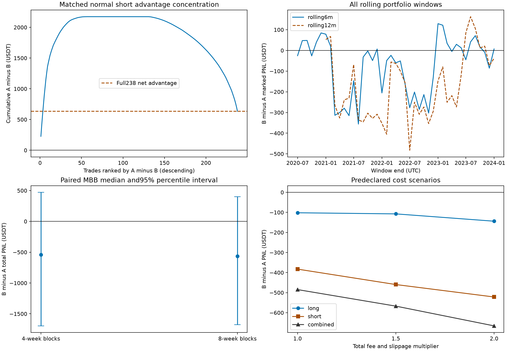
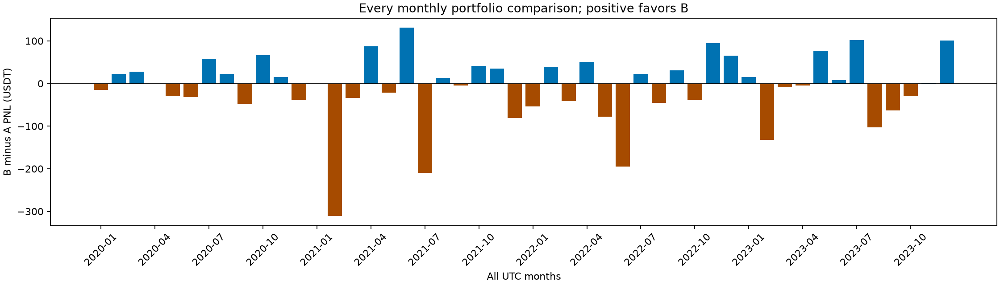

# Step 3：样本内优化偏差与策略稳健性审计

**结论等级：有一定证据但存在明显局限。** A 的总体历史净收益较高，年度及重叠长窗口中有一定时间一致性，且成本压力下相对优势仍在；但优势高度集中，月/季并不普遍占优，配对时间区块Bootstrap的95%收益差区间跨零，完整历史搜索记录缺失，不能据此证明0.38%退出阈值具有独立、可泛化的效果。不把“继续保留A”包装为已证实该条件有效；本轮不选择新参数或升级策略。

**2020—2022用于核心参数优化和质量模型拟合，2023参与配方选择，最终多头cap0.02、空头cap0.08配方选择明确使用2023—2024。2020—2023是已参与历史选择的回顾性样本，不是独立样本外验证。Bootstrap不能修复历史参数搜索的选择偏差。**

## 研究边界与数据

本轮只做归因、时间稳定性和成本敏感性；未拟合/训练模型、未搜索阈值、未改变原始V18、未部署或进入下一步。市场数据仅为Step1 `inputs/ohlcv_closed_pre2024.feather`：140255根已完整收盘的15分钟K线，开盘2020-01-01 00:00至2023-12-31 23:30 UTC，最后完整收盘23:45 UTC，正式起点2020-01-10 23:45 UTC。不读取2024及之后任何行情、指标或交易结果，不使用资金费率，组合持续单持仓、不年度重启。

Step2 A/B完整交易和逐根盯市曲线保留不动。A平仓710笔，组合净利润6954.3495 USDT；B平仓748笔，6469.4992 USDT。原始A−B=484.8502 USDT。以下收益差除集中度/剔除表明确标为 **A−B** 外，均为 **B−A**，正值有利B。

## 1. 参数来源与可追溯性

已检查可用Git历史、冻结登记、模型元数据、最终搜索与质量选择源码、锁定选择元数据及来源审计摘要。Git仅保留此次迁移后的Step1/Step2提交，未保留优化发生时的完整提交、原始搜索日志和所有候选记录；不能用近期文件时间戳冒充历史预注册。`evidence/available_git_history.txt`是实际可用日志。

逐项审计表为 `parameter_provenance.csv`（39行），每个参数含值、历史选择区间、选择依据、实际尝试次数、记录完整性及证据。无法确认项统一标 **UNKNOWN**。摘要如下：

| 参数组 | 冻结值 | 可确认的最终选择/拟合区间 | 依据与记录局限 |
| --- | --- | --- | --- |
| 空头动量退出 | 0.38% | 最终核心搜索2020—2022 | 联合六维方向坐标搜索；0.38单项实际尝试次数UNKNOWN，不是单独的因果验证 |
| 入场M/S/A | 多0.69/0.21/0.340；空0.76/0.49/0.505 | 最终核心搜索2020—2022 | 逐年盈利、最低30交易、DD软惩罚、近优平台/邻域规则；完整候选轨迹缺失 |
| T条件、窗口 | 方向调整T>0，8根 | 初始设计选择期UNKNOWN；最终搜索固定 | 不能推断这些固定值未曾被更早研究选择 |
| 固定止损/亏损早退 | 多3.87%/1.49%；空4.07%/1.43% | 最终核心搜索2020—2022 | 与入场/退出参数联合搜索，实际试验总数UNKNOWN |
| Kalman | q=1e-7、R=.01、dt=.25h；原始斜率反向阈值0 | 初始设计选择期UNKNOWN；最终搜索固定 | 固定不等于从未优化，缺原始设计试验记录 |
| 两根确认及armed | 入场/正常退出/早退均2根；原始armed | 初始选定依据/期UNKNOWN；最终固定 | 源码证明执行值，不证明从未试过一根/其他机制 |
| Ridge权重、尺度、截距、预测门槛 | 逐项精确值见CSV/模型快照；alpha100 | 拟合2020—2022 | cap内标签裁剪，训练预测中位数门槛；所用最终模型与历史frozen_models逐项完全一致，未重新拟合 |
| 最终cap配方 | 多0.02、空0.08 | **2023—2024** | 锁定元数据selection_end=2024-12-31 23:45UTC；源码验证区间到2025前；4候选none/.02/.04/.08按相对收益、回撤和相邻cap最差评分选择 |

最终搜索程序声明3起点、每起点最多20轮、6个活动参数轴、2个最低交易数档（30/75）×4方向案例，C3细网格0.001，其余连续轴0.01；它们是**规定的搜索范围/上限，不是实际尝试次数**。来源摘要记载8个anchor及最终参数，原始 `anchors/30/unfiltered_short.json`、long对应JSON和`.steps.csv`不存在，故每个参数实际评估次数、全生命周期重复次数均UNKNOWN。未重新运行历史优化来填补这些缺口。

质量脚本每方向/档指定3个cap拟合并与none组成4配方候选，可确认的是设计候选数，不是历史总尝试数。原始训练样本台账和完整环境不足，无法重审所有标签生成细节；本轮只核实冻结模型元数据与历史模型逐字段一致、末次训练标签退出时间在2022年底之前。原始完整验证候选评分未保留，故配方选择不能称完整可复核搜索日志。

特别确认：**2024用于选择最终模型/cap配方，未证明2024用于重拟合模型权重。** 源码及标签元数据支持权重拟合在2020—2022；最终“用哪组权重”通过2023—2024选择。因此既不能说2024从未参与，也不能笼统声称权重在2024重新训练。源脚本仅作为文本读取，不导入、不执行；`evidence/`只保存源码、配置、模型元数据和方法片段，不读取历史2024—2026行情或绩效文件。更早设计选择和累计试验次数UNKNOWN，无法量化或校正完整选择偏差。

## 2. 共同正常退出空头与收益集中度

按相同入场时间+方向精确匹配，且A/B都属于正常退出，确为238笔；其中A占优58笔、B占优108笔、近似相同72笔（盈亏差绝对值≤1e-8 USDT）。这不是全部真实组合，也不是所有空头交易。A/B实际组合分别还有其他交易机会及多头贡献。

| cohort | n | A_pnl | B_pnl | A_minus_B |
| --- | --- | --- | --- | --- |
| common_normal_short_238 | 238.0000 | 8783.3193 | 8147.5223 | 635.7969 |
| A_better_58 | 58.0000 | 4016.9781 | 1843.5295 | 2173.4486 |
| B_better_108 | 108.0000 | 1870.0167 | 3407.6683 | -1537.6517 |
| full_actual_portfolio | NA | 6954.3495 | 6469.4992 | 484.8502 |

238笔中58笔A占优总差2173.4486 USDT，被108笔B占优的−1537.6517抵消，剩635.7969。共同正常退出A净利润8783.3193，与所有A正常空头相同；共同B正常空头8147.5223，**不等于B全部263笔正常空头的8132.9666**。差异来自额外交易集合，不能用共同样本直接替代全组合。

以下按 `A净盈亏−B净盈亏` 从大到小排序，top百分比使用ceil取整；对238总样本和58笔正贡献样本都列明分母。排名目的是审计“优势贡献”，不是单独按A绝对盈利排序。全部逐笔及累计值见 `common_normal_short_ranked.csv`，不截尾、不winsorize。

| deletion | removed_n | removed_A_minus_B | share_of_common_net_advantage | share_of_58_positive_advantage | remaining_common_A_minus_B | diagnostic_ledger_A_minus_B |
| --- | --- | --- | --- | --- | --- | --- |
| top5 | 5 | 885.4598 | 1.3927 | 0.4074 | -249.6628 | -400.6095 |
| top10 | 10 | 1425.5028 | 2.2421 | 0.6559 | -789.7058 | -940.6526 |
| top20 | 20 | 1820.2057 | 2.8629 | 0.8375 | -1184.4088 | -1335.3555 |
| top5pct_of238 | 12 | 1543.6596 | 2.4279 | 0.7102 | -907.8626 | -1058.8094 |
| top10pct_of238 | 24 | 1920.2645 | 3.0202 | 0.8835 | -1284.4676 | -1435.4143 |
| top20pct_of238 | 48 | 2164.3918 | 3.4042 | 0.9958 | -1528.5948 | -1679.5416 |
| top5pct_of58 | 3 | 574.8781 | 0.9042 | 0.2645 | 60.9189 | -90.0279 |
| top10pct_of58 | 6 | 1018.7535 | 1.6023 | 0.4687 | -382.9565 | -533.9033 |
| top20pct_of58 | 12 | 1543.6596 | 2.4279 | 0.7102 | -907.8626 | -1058.8094 |

前5/10/20笔A−B优势贡献分别885.4598/1425.5028/1820.2057 USDT，占58笔正贡献约40.74%/65.59%/83.75%，占共同样本净优势139.27%/224.21%/286.29%。百分比超过100%是因为其他交易抵消，不能截成100%。前5%（12笔）、10%（24笔）、20%（48笔）交易贡献也完整披露。**剔除前5笔后共同样本A−B转为−249.6628，完整已发生交易台账同时扣掉这5笔配对交易后的A−B为−400.6095。** 原始正式结果仍为A−B=484.8502，绝不以删后结果取代。

剔除只在双方已发生交易台账中移除同一对入场，不重新释放仓位、不重建资金曲线、不模拟后续替代交易，故 `diagnostic_ledger_*` 只是会计敏感性，**不是可实现的新策略收益**。不把删后PF、回撤或Sharpe伪装为重新回放结果，也不根据删后结果修改策略。少数大收益可来自趋势策略正常厚尾结构；集中本身不证明无效，但削弱“普遍持续优于B”的推断。

## 3. 全时间窗口稳定性

使用同一已发生真实组合曲线，不在窗口起点重开/平仓。每窗口净利润=结束盯市−开始前最后盯市，DD含该窗口初始基准；PF和交易笔数按窗口内退出归属，跨窗口持仓会导致平仓盈亏和盯市利润不同。Sharpe用每日盯市盈亏/1000，零无风险利率、样本标准差、√365年化。无亏损窗口PF为NA，不编造无穷或0。

覆盖全部4年度、16季度、48个月、43个滚动6月、37个滚动12月窗口×3方向，共444行，均在 `time_stability_all_windows.csv`；没有只取有利区间。滚动窗每月移动，完全重叠并非独立重复试验。2020首次窗口始于正式起点，2020年1月为部分月，含该月的首个6/12月窗口亦应理解为扣除统一预热后的窗口，不补齐虚构的空仓历史。

| window | A_net_profit | B_net_profit | B_minus_A_net_profit | A_profit_factor | B_profit_factor | A_sharpe | B_sharpe | A_max_drawdown | B_max_drawdown | A_trades_closed | B_trades_closed |
| --- | --- | --- | --- | --- | --- | --- | --- | --- | --- | --- | --- |
| 2020 | 2151.3348 | 2204.1460 | 52.8113 | 1.6049 | 1.6232 | 1.6332 | 1.6843 | 754.0565 | 696.5069 | 172 | 179 |
| 2021 | 2035.4031 | 1683.5255 | -351.8776 | 1.4102 | 1.3324 | 1.5255 | 1.3054 | 815.5356 | 817.6198 | 194 | 201 |
| 2022 | 2862.5911 | 2714.8286 | -147.7626 | 1.6129 | 1.5590 | 2.3350 | 2.2234 | 454.5050 | 531.3772 | 218 | 227 |
| 2023 | -94.9795 | -133.0009 | -38.0213 | 0.9540 | 0.9299 | -0.1990 | -0.3052 | 672.6524 | 616.1037 | 126 | 141 |

| window_type | direction | windows | A_profit_above_B_n | B_profit_above_A_n | equal_n | A_lower_drawdown_n | A_higher_PF_n | A_higher_sharpe_n | median_B_minus_A_net | min_B_minus_A_net | max_B_minus_A_net |
| --- | --- | --- | --- | --- | --- | --- | --- | --- | --- | --- | --- |
| annual | combined | 4 | 3 | 1 | 0 | 2 | 3 | 3 | -92.8919 | -351.8776 | 52.8113 |
| annual | long | 4 | 2 | 2 | 0 | 1 | 3 | 2 | -9.9362 | -113.4544 | 31.3363 |
| annual | short | 4 | 3 | 1 | 0 | 2 | 2 | 3 | -44.8044 | -314.7259 | 21.4750 |
| monthly | combined | 48 | 23 | 23 | 2 | 13 | 22 | 20 | 0.0000 | -310.3768 | 131.0893 |
| monthly | long | 48 | 10 | 17 | 21 | 11 | 8 | 11 | 0.0000 | -111.9606 | 69.6478 |
| monthly | short | 48 | 19 | 27 | 2 | 13 | 21 | 20 | 14.9612 | -310.3768 | 95.6524 |
| quarterly | combined | 16 | 8 | 8 | 0 | 5 | 9 | 8 | 1.8029 | -344.3801 | 197.9701 |
| quarterly | long | 16 | 6 | 8 | 2 | 7 | 6 | 6 | 0.1236 | -111.8519 | 58.5466 |
| quarterly | short | 16 | 7 | 9 | 0 | 5 | 8 | 8 | 10.2011 | -304.2458 | 159.2905 |
| rolling12m | combined | 37 | 30 | 7 | 0 | 14 | 31 | 30 | -230.5983 | -482.4314 | 163.0764 |
| rolling12m | long | 37 | 19 | 18 | 0 | 22 | 29 | 23 | -1.4938 | -247.4253 | 115.5842 |
| rolling12m | short | 37 | 27 | 10 | 0 | 19 | 25 | 26 | -95.5592 | -418.0993 | 148.6136 |
| rolling6m | combined | 43 | 27 | 16 | 0 | 12 | 30 | 26 | -26.4247 | -356.0449 | 129.2012 |
| rolling6m | long | 43 | 22 | 20 | 1 | 20 | 24 | 21 | -1.4547 | -300.3340 | 113.6566 |
| rolling6m | short | 43 | 25 | 18 | 0 | 21 | 26 | 26 | -25.5830 | -387.6839 | 156.8623 |

组合A在3/4年、27/43滚动6月、30/37滚动12月收益高于B，但季度8比8、月度23比23且2月相同，不存在每月普遍占优；空头月度A高于B19/48，B高于A27/48。长窗较一致支持**一定时间证据**，但高度重叠、同一批大交易反复出现会放大表面重复性，不能用30/37当30个独立成功实验。

## 4. 配对时间区块Bootstrap

基准为正式起点至2023-12-31最后完整收盘的**1452个UTC日**末次盯市盈亏序列，包含空仓日；第一天为正式起点后的部分日，最后一天截至23:45。数值先用USDT每日增量存储，收益率是其/1000，固定不复利。A/B以及多空分解始终抽取同一日历索引区块。

使用noncircular overlapping moving-block bootstrap，所有合法连续28天/56天起点等概率有放回抽取，分别代表4周/8周连续区块（可从任意UTC日开始，并非只周一）。每次抽ceil(N/L)块，最后一块截到刚好1452日；不跨首尾循环、不中心化。每种长度20000次，种子20261108+L。以抽样总B−A USDT分布的2.5%/97.5%分位数形成百分位95%区间，另输出B−A>0的经验比例；非逐笔IID抽样。原始40000个配对重复合计及方向分解保存在 `bootstrap_paired_replicates.csv.gz`，区块均同索引且经线性一致性核验。

| block_days | replicates | direction | observed_B_minus_A | bootstrap_median | percentile95_low | percentile95_high | fraction_B_minus_A_gt0 |
| --- | --- | --- | --- | --- | --- | --- | --- |
| 28 | 20000 | long | -101.9905 | -118.4314 | -597.4619 | 324.5963 | 0.3065 |
| 28 | 20000 | short | -382.8597 | -408.4281 | -1565.5685 | 569.3520 | 0.2198 |
| 28 | 20000 | combined | -484.8502 | -539.6078 | -1695.6253 | 471.6294 | 0.1582 |
| 56 | 20000 | long | -101.9905 | -129.3050 | -596.0900 | 279.4407 | 0.2733 |
| 56 | 20000 | short | -382.8597 | -427.7817 | -1538.2674 | 546.3081 | 0.2070 |
| 56 | 20000 | combined | -484.8502 | -565.4290 | -1674.7212 | 399.6578 | 0.1322 |

组合28天区块95%区间约[−1695.63,471.63] USDT，B−A>0比例15.815%；56天约[−1674.72,399.66]，比例13.22%。**两者均跨零，不能给出A优于B的95%稳健结论。** 经验比例不是p值、不是“B真正更优的后验概率”，也不是未来胜率。原始估计−484.85和抽样均值/中位数不完全一致，是非循环边界权重、有限样本和区块截尾造成的，未为贴近原始估计重新调方法。

局限：区块内保留部分依赖，区块拼接破坏更长期关系和市场状态顺序；原样本高度非平稳，仅4年；不能再现新市场路径中的自适应交易执行，只对已发生的每日曲线抽样。4/8周是预指定两个敏感性尺度，不能看哪种显著就挑哪种。**Bootstrap条件于已经选好的策略/模型，既不重新执行历史参数选择，也不能恢复其缺失试验次数，所以无法修复数据窥探、多次搜索、cap选择或研究者选择偏差。** 本轮不能给出偏差校正后的净优势或deflated Sharpe结论。

## 5. 交易成本压力

将“1.5倍、2倍”明确解释为**总成本分别为基准的1.5×/2×**，手续费和滑点每边同时乘倍数：1×为0.05%/0.02%；1.5×为0.075%/0.03%；2×为0.10%/0.04%。未按“额外加1.5×即2.5×总成本”解释。仅三个预指定成本情景，不搜索参数或择优成本。

每情景对A/B做完整持续单持仓重放，指标、M/S/A/T和Ridge门槛/分数/入场资格、正常/早退/止损逻辑与优先级全部不变，只有成交滑点、手续费及预留手续费数量发生变化。**成本改变成交入场价，因此相对入场价的止损价与早退盈亏条件可能随之改变，后续成交集合可能变化**；这是原逻辑在新执行成本下的内生结果，不是修改信号公式。本轮每个成本情景均由独立标量执行器核对订单、成交价与资金曲线，并保存交易与逐根资金曲线；1×曲线与Step2再次对账。

| cost_multiplier | variant | direction | fee_per_side | slippage_per_side | net_profit | max_drawdown | profit_factor | sharpe | trades_closed | open_n |
| --- | --- | --- | --- | --- | --- | --- | --- | --- | --- | --- |
| 1.0000 | A | long | 0.0005 | 0.0002 | 4766.5639 | 683.2595 | 1.7456 | 1.5859 | 345 | 0 |
| 1.0000 | A | short | 0.0005 | 0.0002 | 2187.7855 | 858.6086 | 1.2462 | 0.6256 | 365 | 0 |
| 1.0000 | A | combined | 0.0005 | 0.0002 | 6954.3495 | 815.5356 | 1.4552 | 1.5163 | 710 | 0 |
| 1.0000 | B | long | 0.0005 | 0.0002 | 4664.5734 | 648.0456 | 1.6713 | 1.5129 | 365 | 0 |
| 1.0000 | B | short | 0.0005 | 0.0002 | 1804.9258 | 1059.7601 | 1.2138 | 0.5434 | 383 | 0 |
| 1.0000 | B | combined | 0.0005 | 0.0002 | 6469.4992 | 817.6198 | 1.4204 | 1.4367 | 748 | 0 |
| 1.5000 | A | long | 0.0008 | 0.0003 | 4265.1326 | 734.0445 | 1.6402 | 1.4179 | 346 | 0 |
| 1.5000 | A | short | 0.0008 | 0.0003 | 1553.2300 | 1103.9741 | 1.1671 | 0.4433 | 366 | 0 |
| 1.5000 | A | combined | 0.0008 | 0.0003 | 5818.3627 | 917.0290 | 1.3647 | 1.2653 | 712 | 0 |
| 1.5000 | B | long | 0.0008 | 0.0003 | 4157.5867 | 701.6543 | 1.5765 | 1.3473 | 365 | 0 |
| 1.5000 | B | short | 0.0008 | 0.0003 | 1093.5332 | 1371.4566 | 1.1232 | 0.3287 | 384 | 0 |
| 1.5000 | B | combined | 0.0008 | 0.0003 | 5251.1199 | 863.2480 | 1.3264 | 1.1634 | 749 | 0 |
| 2.0000 | A | long | 0.0010 | 0.0004 | 3739.7171 | 784.7944 | 1.5390 | 1.2436 | 346 | 0 |
| 2.0000 | A | short | 0.0010 | 0.0004 | 1077.0264 | 1233.4994 | 1.1124 | 0.3070 | 366 | 0 |
| 2.0000 | A | combined | 0.0010 | 0.0004 | 4816.7435 | 1007.0244 | 1.2916 | 1.0458 | 712 | 0 |
| 2.0000 | B | long | 0.0010 | 0.0004 | 3595.7145 | 755.2258 | 1.4786 | 1.1650 | 365 | 0 |
| 2.0000 | B | short | 0.0010 | 0.0004 | 555.3421 | 1506.4179 | 1.0603 | 0.1666 | 384 | 0 |
| 2.0000 | B | combined | 0.0010 | 0.0004 | 4151.0565 | 1081.6928 | 1.2483 | 0.9174 | 749 | 0 |

| cost_multiplier | direction | B_minus_A_net_profit | B_minus_A_max_drawdown | B_minus_A_profit_factor | B_minus_A_sharpe | B_minus_A_trades_closed |
| --- | --- | --- | --- | --- | --- | --- |
| 1.0000 | long | -101.9905 | -35.2139 | -0.0743 | -0.0731 | 20 |
| 1.0000 | short | -382.8597 | 201.1515 | -0.0324 | -0.0823 | 18 |
| 1.0000 | combined | -484.8502 | 2.0842 | -0.0348 | -0.0796 | 38 |
| 1.5000 | long | -107.5459 | -32.3903 | -0.0637 | -0.0706 | 19 |
| 1.5000 | short | -459.6969 | 267.4825 | -0.0439 | -0.1146 | 18 |
| 1.5000 | combined | -567.2428 | -53.7810 | -0.0383 | -0.1019 | 37 |
| 2.0000 | long | -144.0026 | -29.5686 | -0.0604 | -0.0787 | 19 |
| 2.0000 | short | -521.6844 | 272.9185 | -0.0521 | -0.1403 | 18 |
| 2.0000 | combined | -665.6870 | 74.6684 | -0.0433 | -0.1284 | 37 |

组合A−B净收益差在1×/1.5×/2×分别为484.8502/567.2428/665.6870 USDT，利润排序保持。但回撤不一致：1.5×下A组合DD为917.0290、B为863.2480，**B回撤更低53.7810 USDT**；2×下A为1007.0244、B为1081.6928，A回撤较低。不能据成本压力把A描述成在全部指标上占优，且压力下两版本绝对利润都明显下降。

另附 `fixed_ledger_cost_sensitivity.csv`：锁定原始已发生交易时点、原始无滑点价格，再改变双边成本重算，1×精确重现原始净收益。此项只隔离会计成本变化，连原止损的无滑点退出价也固定，**不声称是新成本下完整合法执行路径**；正式压力结果以上述全回放为准。两种口径同时披露，避免将固定交易扣成本与完整重放混淆。均未使用资金费率。

## 6. 最终证据分级

选择：**有一定证据但存在明显局限**。

- 已测得：A在原样本总体、3/4单年及多数滚动长窗收益较高；预指定成本压力的相对关系可直接核查。238共同正常空头的优势高度集中，前5笔已超过净优势；短窗口并不普遍占优。
- 尚不能证明：0.38%阈值具有普遍、独立、可泛化的退出效果；A未来将优于B。两种区块Bootstrap95%区间跨零，且不会纠正选择偏差。
- 证据缺口：完整原始搜索次数/轨迹、初始机制设计历史、所有模型候选验证记录，以及未参与选择的独立证据。未知项保留UNKNOWN，不补造试验数量。

这一分级强于只复述总利润，但**不等于“稳定性证据较强”**，也不将过去样本重新命名为样本外。若研究负责人采用更严格的“必须独立验证”标准，则目前最多只能认定历史样本内优势；本报告的“一定证据”仅指条件于已冻结配置的时间和成本敏感性。无需由本轮决定新参数、继续优化或部署。

图表保留全部窗口与交易，不截去反向贡献；ECDF/区间表所用原始数值可在CSV复查。来源、参数表、所有正式结果与剔除诊断分别保留。初次脚本有日历时区端点错误、第二次独立成本核验截获诊断代码的手续费字符串替换错误；均已修复并保留失败日志，未改任何交易规则、模型或阈值，最终以成功 `run.log` 为准。

复现：`python run_step3.py` → `python build_report.py` → `python validate_step3.py`。分析目录须保留在当前仓库结构，源证据路径见 `evidence_index.csv`。本轮结束，等待研究负责人审阅；不自行进入下一阶段。
