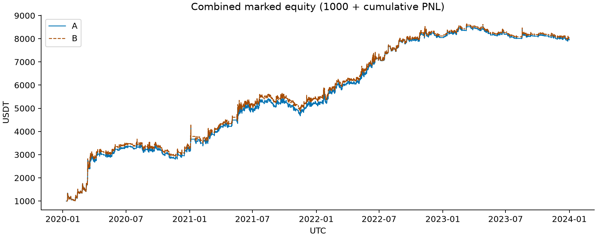
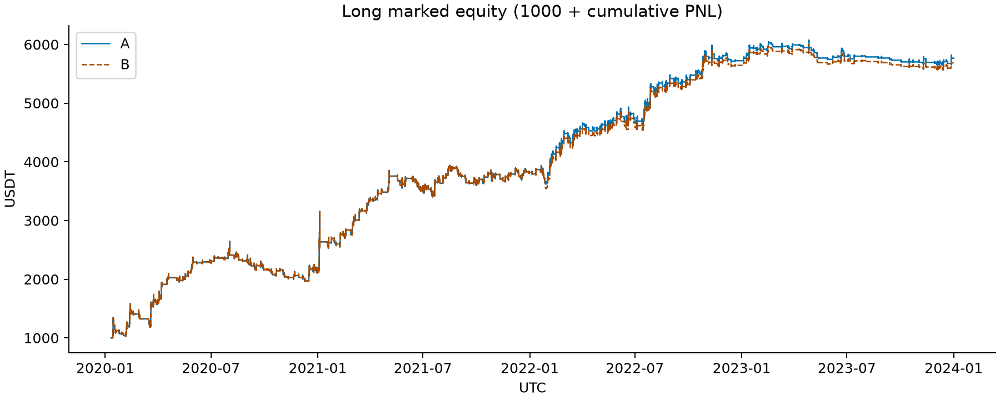
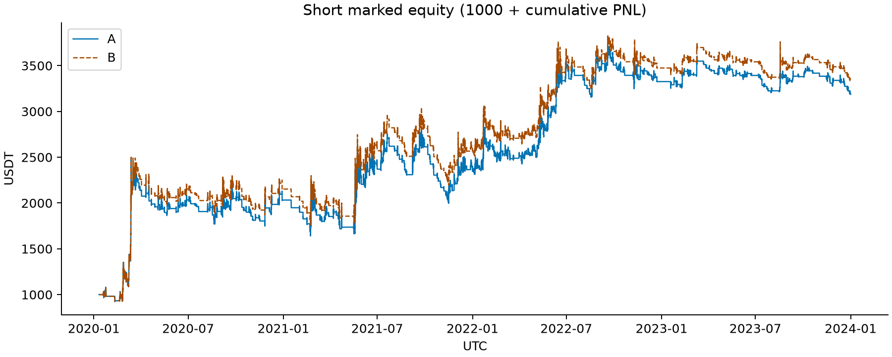
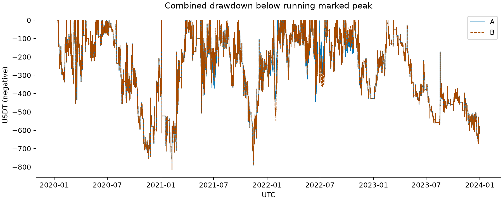
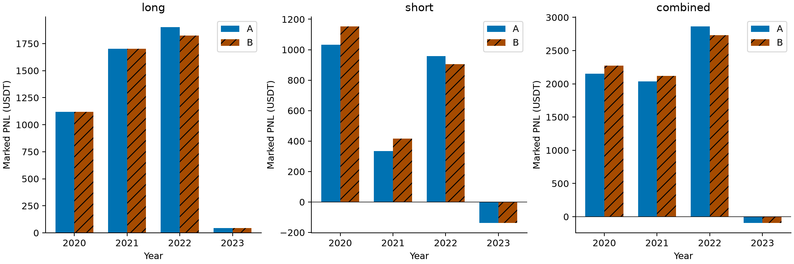
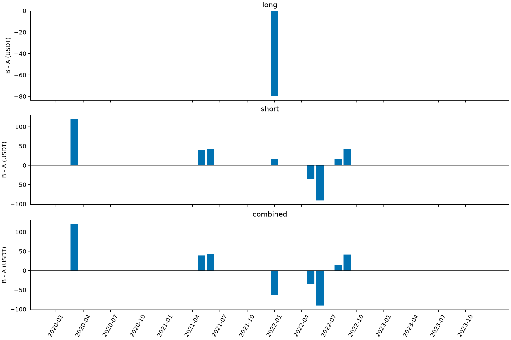
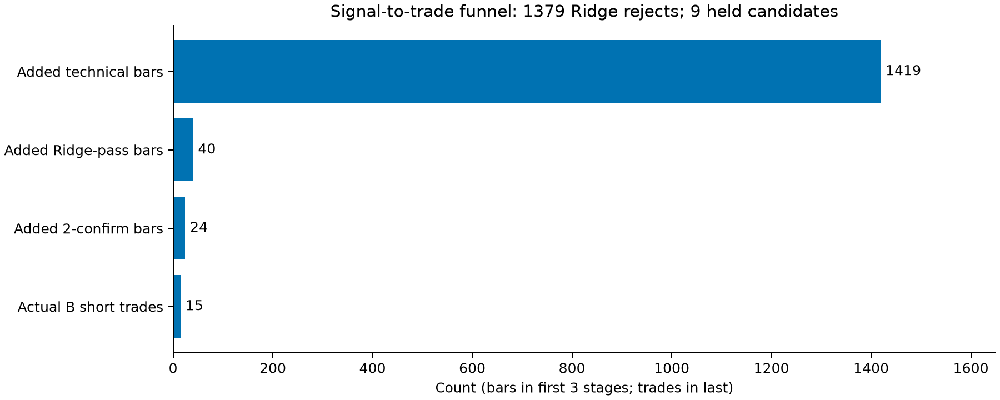
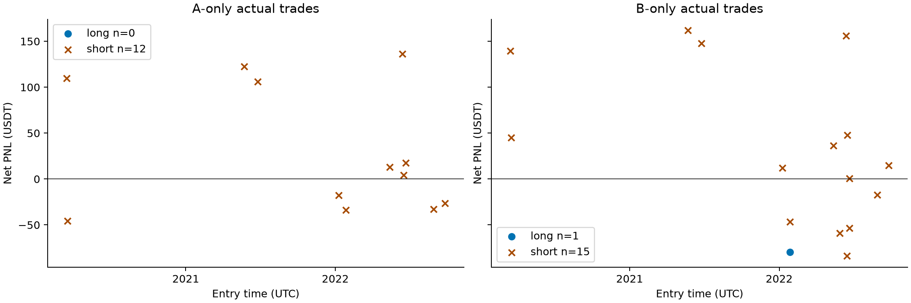

# V19 Step 4：空头显式 S 门槛单因素消融

任务：`V19_STEP4_SHORT_S_GATE_ABLATION_2020_2023`。结论：**存在小幅历史改善，但证据不足以升级；保留 A，B 仅作为待审阅的简化候选。**

## 冻结范围与执行门禁

A 为原始 V18，不采用 Step 2 B。B 仅在独立月度计划把 short C2 从注册值 0.49 改为 `-inf`，这是绕过显式比较的标记；Ridge 六项输入（包括 S）、系数、标准化和门槛完全保留。原空头 momentum 0.38 退出、armed、两根确认、多头全部规则、止损、早退、单持仓与执行优先级均未更改。

每笔保证金预算 1000 USDT、2 倍杠杆、不复利；单边手续费 0.05%、滑点 0.02%，无资金费率、无年度重启。A/B 分别从头连续回放，没有把候选收益叠加到旧交易表。先复现 A，再核验候选，之后才执行 B；日志保存顺序。A 与 Step 1 的逐笔时间、方向、退出原因、成交价和完整资金曲线一致，710 笔平仓、0 未平仓，总净利润 6954.349451 USDT，2023 年 -94.979541 USDT。

A/B 均通过独立标量执行器的零滑点和原始成本订单顺序、入场价、退出价及完整资金曲线核验。共有交易的退出时间、原因、成交价和净利润完全相同。输入和前期产物哈希前后相同；只新增 Step 4 文件。

## 数据与统计口径

仅读取已验证的 `inputs/ohlcv_closed_pre2024.feather`，140255 根连续 15 分钟完整收盘K线；从 2020-01-01 00:00 UTC 开始预热，正式起点 2020-01-10 23:45 UTC。最后开盘 2023-12-31 23:30，最后完整收盘 23:45；截止 23:59:59 UTC。4 小时 EMA 使用原始实现的已收盘可用时间，已验证因果时间关系。不读取 2024 年及之后行情、指标或交易结果。

**这是历史已选模型的回溯实验，不是独立样本外验证。** 原模型历史选择范围涉及 2023—2024；2023 年也不能标为独立 OOS。这里保留冻结权重，并未读取该时期之后的行情或重训。

净利润/年度/月度收益采用连续组合的收盘盯市变化，跨年不重启；交易胜率、PF、均盈亏、持仓、MFE/MAE及回吐按退出所属区间统计，因此年内交易已实现利润与年内盯市变化可能不同。Sharpe 为固定 1000 USDT 分母的日盯市增量，按 sqrt(365) 年化；Sortino 下行分母为含非负日零值的负收益平方均值平方根，目标收益为零。收益回撤比=区间净利润/区间最大货币回撤；回撤包含区间前基准峰值。MFE/MAE 为完整持有K线的高低价诊断；止损触发的部分持有K线被排除，极值诊断属于下界而非精确盘中路径；回吐为原诊断定义的 MFE 减毛价格退出收益，单位百分点，均不是额外可成交收益。

## 总体与分方向绩效（差值均为 B−A）

| direction | metric | A | B | B_minus_A |
| --- | --- | --- | --- | --- |
| long | net_profit_marked | 4766.563935 | 4686.858161 | -79.705775 |
| long | max_drawdown_currency | 683.259520 | 683.259520 | 0.000000 |
| long | return_drawdown_ratio | 6.976213 | 6.859558 | -0.116655 |
| long | profit_factor | 1.745611 | 1.724115 | -0.021496 |
| long | sharpe | 1.585947 | 1.557071 | -0.028876 |
| long | sortino | 3.476847 | 3.395952 | -0.080895 |
| long | win_rate | 0.469565 | 0.468208 | -0.001357 |
| long | mean_win | 68.885142 | 68.885142 | 0.000000 |
| long | mean_loss | -34.933492 | -35.176819 | -0.243328 |
| long | trades_closed | 345.000000 | 346.000000 | 1.000000 |
| long | mean_holding_hours | 16.847826 | 16.815029 | -0.032797 |
| long | median_holding_hours | 15.750000 | 15.750000 | 0.000000 |
| long | mean_MFE_pct | 3.661115 | 3.654737 | -0.006378 |
| long | mean_MAE_pct | -1.599776 | -1.604580 | -0.004804 |
| long | mean_giveback_pct | 2.855960 | 2.863189 | 0.007229 |
| short | net_profit_marked | 2187.785516 | 2336.256481 | 148.470965 |
| short | max_drawdown_currency | 858.608635 | 832.390445 | -26.218190 |
| short | return_drawdown_ratio | 2.548059 | 2.806683 | 0.258624 |
| short | profit_factor | 1.246208 | 1.259879 | 0.013671 |
| short | sharpe | 0.625624 | 0.660120 | 0.034497 |
| short | sortino | 1.338971 | 1.407805 | 0.068834 |
| short | win_rate | 0.394521 | 0.399457 | 0.004936 |
| short | mean_win | 76.900694 | 77.047857 | 0.147163 |
| short | mean_loss | -40.207757 | -40.677731 | -0.469973 |
| short | trades_closed | 365.000000 | 368.000000 | 3.000000 |
| short | mean_holding_hours | 19.047945 | 19.077446 | 0.029500 |
| short | median_holding_hours | 16.500000 | 16.500000 | 0.000000 |
| short | mean_MFE_pct | 4.311499 | 4.318431 | 0.006932 |
| short | mean_MAE_pct | -1.810408 | -1.802787 | 0.007621 |
| short | mean_giveback_pct | 3.911852 | 3.901055 | -0.010797 |
| combined | net_profit_marked | 6954.349452 | 7023.114642 | 68.765190 |
| combined | max_drawdown_currency | 815.535637 | 815.535637 | 0.000000 |
| combined | return_drawdown_ratio | 8.527340 | 8.611659 | 0.084319 |
| combined | profit_factor | 1.455165 | 1.454209 | -0.000956 |
| combined | sharpe | 1.516324 | 1.518248 | 0.001924 |
| combined | sortino | 3.154521 | 3.127591 | -0.026930 |
| combined | win_rate | 0.430986 | 0.432773 | 0.001787 |
| combined | mean_win | 72.657166 | 72.768375 | 0.111209 |
| combined | mean_loss | -37.818672 | -38.178551 | -0.359879 |
| combined | trades_closed | 710.000000 | 714.000000 | 4.000000 |
| combined | mean_holding_hours | 17.978873 | 17.981092 | 0.002219 |
| combined | median_holding_hours | 16.000000 | 16.000000 | 0.000000 |
| combined | mean_MFE_pct | 3.995939 | 3.997289 | 0.001350 |
| combined | mean_MAE_pct | -1.708211 | -1.706881 | 0.001331 |
| combined | mean_giveback_pct | 3.399544 | 3.398862 | -0.000682 |

## 年度与合并区间

| period | direction | net_profit_marked_A | net_profit_marked_B | B_minus_A_net_profit_marked | max_drawdown_currency_A | max_drawdown_currency_B | B_minus_A_max_drawdown_currency |
| --- | --- | --- | --- | --- | --- | --- | --- |
| 2020-2023 | long | 4766.563935 | 4686.858161 | -79.705775 | 683.259520 | 683.259520 | 0.000000 |
| 2020-2023 | short | 2187.785516 | 2336.256481 | 148.470965 | 858.608635 | 832.390445 | -26.218190 |
| 2020-2023 | combined | 6954.349452 | 7023.114642 | 68.765190 | 815.535637 | 815.535637 | 0.000000 |
| 2020-2022 | long | 4723.696863 | 4643.991088 | -79.705775 | 683.259520 | 683.259520 | 0.000000 |
| 2020-2022 | short | 2325.632130 | 2474.103095 | 148.470965 | 858.608635 | 832.390445 | -26.218190 |
| 2020-2022 | combined | 7049.328993 | 7118.094183 | 68.765190 | 815.535637 | 815.535637 | 0.000000 |
| 2020 | long | 1119.045460 | 1119.045460 | 0.000000 | 683.259520 | 683.259520 | 0.000000 |
| 2020 | short | 1032.289301 | 1152.329822 | 120.040520 | 751.279007 | 631.238487 | -120.040520 |
| 2020 | combined | 2151.334761 | 2271.375282 | 120.040520 | 754.056517 | 754.056517 | -0.000000 |
| 2021 | long | 1700.806115 | 1700.806115 | 0.000000 | 630.527426 | 630.527426 | 0.000000 |
| 2021 | short | 334.596976 | 415.776678 | 81.179701 | 832.390445 | 832.390445 | 0.000000 |
| 2021 | combined | 2035.403091 | 2116.582792 | 81.179701 | 815.535637 | 815.535637 | 0.000000 |
| 2022 | long | 1903.845288 | 1824.139513 | -79.705775 | 319.587007 | 399.261114 | 79.674107 |
| 2022 | short | 958.745852 | 905.996595 | -52.749257 | 488.862945 | 515.664712 | 26.801767 |
| 2022 | combined | 2862.591140 | 2730.136109 | -132.455032 | 454.504969 | 546.958069 | 92.453100 |
| 2023 | long | 42.867073 | 42.867073 | 0.000000 | 429.813394 | 429.813394 | 0.000000 |
| 2023 | short | -137.846614 | -137.846614 | 0.000000 | 423.435789 | 423.435789 | 0.000000 |
| 2023 | combined | -94.979541 | -94.979541 | 0.000000 | 672.652439 | 672.652439 | 0.000000 |

## 候选到成交

| period | direction | added_technical | ridge_rejected_added | added_single_full | added_two_confirm_candidate_bars | B_actual_openings_at_added_candidates | B_candidates_blocked_by_hold | B_candidates_blocked_by_sold_candle | A_actual_openings_at_added_candidates |
| --- | --- | --- | --- | --- | --- | --- | --- | --- | --- |
| 2020-2023 | short | 1419 | 1379 | 40 | 24 | 15 | 9 | 0 | 0 |
| 2020 | short | 381 | 369 | 12 | 5 | 2 | 3 | 0 | 0 |
| 2021 | short | 608 | 604 | 4 | 2 | 2 | 0 | 0 | 0 |
| 2022 | short | 331 | 307 | 24 | 17 | 11 | 6 | 0 | 0 |
| 2023 | short | 99 | 99 | 0 | 0 | 0 | 0 | 0 | 0 |

1419 根新增技术候选中，1379 根被原 Ridge 拒绝，仅剩 40 根新增完整单根信号，形成 24 根新增两根确认候选。24 是信号K线计数，不是独立事件或交易数；其中 15 根对应 B 实际空头开仓，9 根受已有持仓占用而未开仓。本轮无卖出当根重置阻挡的新增候选。逐根记录见 `confirmed_candidate_conversion.csv`，技术差异与原 S 值保留在 `entry_signal_differences.csv`。

## 实际交易集合与占位效应

共有 698 笔；A 独有 12 笔（全为空头），B 独有 16 笔（15 空头、1 多头）。所以总交易净增加 4 笔，不应把 B 独有 16 笔都称作净新增。相同入场时间及方向的 698 笔退出全部一致。

| arm | direction | trades | net_pnl |
| --- | --- | --- | --- |
| A-only | long | 0 | 0.000000 |
| A-only | short | 12 | 353.085015 |
| A-only | combined | 12 | 353.085015 |
| B-only | long | 1 | -79.705775 |
| B-only | short | 15 | 501.555980 |
| B-only | combined | 16 | 421.850205 |

B 独有净利润 421.850205 − A 独有净利润 353.085015 = 组合净改善 68.765190 USDT。A 独有交易在对应入场时均有 B 空头占位，映射见 `A_only_trades.csv`；这是路径占位证据，不是独立因果质量评分。B 的 15 笔不同空头与原路径 12 笔空头相替换，另释放一个原来没有的多头机会，而该多头最终固定止损 -79.705775 USDT。

## 退出结构

| direction | exit_group | n_A | net_pnl_A | mean_holding_hours_A | mean_MFE_pct_A | mean_MAE_pct_A | mean_giveback_pct_A | n_B | net_pnl_B | mean_holding_hours_B | mean_MFE_pct_B | mean_MAE_pct_B | mean_giveback_pct_B | B_minus_A_n | B_minus_A_net_pnl | B_minus_A_mean_holding_hours | B_minus_A_mean_MFE_pct | B_minus_A_mean_MAE_pct | B_minus_A_mean_giveback_pct |
| --- | --- | --- | --- | --- | --- | --- | --- | --- | --- | --- | --- | --- | --- | --- | --- | --- | --- | --- | --- |
| long | early_loss | 43 | -2038.458581 | 9.709302 | 1.165824 | -2.715178 | 3.438446 | 43 | -2038.458581 | 9.709302 | 1.165824 | -2.715178 | 3.438446 | 0 | 0.000000 | 0.000000 | 0.000000 | 0.000000 | 0.000000 |
| long | fixed_stop | 32 | -2550.584795 | 4.906250 | 1.163575 | -2.959923 | 5.052801 | 33 | -2630.290570 | 4.924242 | 1.172862 | -2.969217 | 5.062088 | 1 | -79.705775 | 0.017992 | 0.009287 | -0.009294 | 0.009287 |
| long | normal | 270 | 9355.607312 | 19.400000 | 4.345268 | -1.265973 | 2.510964 | 270 | 9355.607312 | 19.400000 | 4.345268 | -1.265973 | 2.510964 | 0 | -0.000000 | 0.000000 | 0.000000 | 0.000000 | 0.000000 |
| short | early_loss | 101 | -4416.336481 | 8.373762 | 1.161465 | -2.680078 | 3.247820 | 102 | -4476.468641 | 8.438725 | 1.149725 | -2.680065 | 3.244122 | 1 | -60.132161 | 0.064963 | -0.011740 | 0.000013 | -0.003698 |
| short | fixed_stop | 26 | -2179.197293 | 9.538462 | 2.102094 | -3.140865 | 6.192908 | 27 | -2263.012573 | 9.240741 | 2.031073 | -3.145816 | 6.121887 | 1 | -83.815280 | -0.297721 | -0.071021 | -0.004952 | -0.071021 |
| short | normal | 238 | 8783.319290 | 24.616597 | 5.889641 | -1.296002 | 3.944456 | 239 | 9075.737696 | 24.729079 | 5.929170 | -1.276661 | 3.930531 | 1 | 292.418406 | 0.112483 | 0.039529 | 0.019341 | -0.013926 |

短空头正常退出 238→239、早退 101→102、固定止损 26→27；多头止损 32→33。规则没有变化，结构变化源于入场和占位路径。正常退出空头利润增加 292.418406 USDT，但空头早退和止损利润分别下降 60.132160 和 83.815280 USDT。共有入场没有退出差异，PnL 浮点误差上限为 1e-9 USDT（观测最大 1.78e-12），未改变成交。

## 月度集中度

48 个月中 8 个月组合收益有非零差异；改善月 5，恶化月 3，其余无变化。下表按绝对差异排列全部变化月（不是只展示改善月份）。

| month | net_pnl_marked_A | net_pnl_marked_B | B_minus_A_net_pnl_marked |
| --- | --- | --- | --- |
| 2020-03 | 1199.113033 | 1319.153553 | 120.040520 |
| 2022-06 | 496.610584 | 405.843441 | -90.767144 |
| 2022-01 | 163.330204 | 100.537261 | -62.792942 |
| 2021-06 | 27.715059 | 69.667753 | 41.952694 |
| 2022-09 | 7.426182 | 48.801680 | 41.375498 |
| 2021-05 | 714.278048 | 753.505055 | 39.227007 |
| 2022-05 | 610.469644 | 574.776594 | -35.693050 |
| 2022-08 | 227.036003 | 242.458609 | 15.422606 |

## Q1—Q8

1. **实际交易增加多少？** 710→714，净增 4 笔；空头 365→368（+3）、多头 345→346（+1）。15 个新增确认候选实际成为空头交易，但替代了 12 个 A 独有空头。
2. **新增交易是否贡献净利润？** B 独有减 A 独有后仅 +68.765190 USDT（约为 A 总净利润的 0.99%）；空头 +148.470965，多头 -79.705775。不能只加总 B 独有盈利。
3. **原空头结构是否改变？** 12 个原入场被不同时间的空头占位；共有入场退出完全一致。正常退出、早退和固定止损各净增 1 笔。
4. **是否挤占更优空头？** 有盈利的 A 交易被占位，不能声称所有替换更优；2022 空头净利润下降 52.749257 USDT。逐笔盈亏与占位编号完整交付，整体空头收益增加并不能保证每个替换都改善。
5. **是否影响多头？** 是。规则相同但路径变化新增一个多头，亏损 79.705775 USDT；原多头均保留。
6. **收益与最大回撤？** 组合净利润 6954.349452→7023.114642，+68.765190；最大回撤 815.535637→815.535637 USDT，未改善。空头回撤 858.608635→832.390445，改善 26.218190；多头回撤不变。
7. **是否集中于少数年份/月？** 是，2020 +120.040520、2021 +81.179701、2022 -132.455032、2023 为零。所有真实变化集中在前述少数月份；2023 无新增完整信号，也没有交易变化，不能算作独立支持证据。
8. **能否保留简化候选？** 可留待负责人评审，但不足以支持策略升级。有效不同空头只有 15 笔，净增仅 3 笔，改善幅度小、年度不一致且多头损失抵消部分空头收益。本轮无 bootstrap、参数搜索或显著性宣称。

## 图表与复现

图表为内部研究展示，无平滑、截尾或统计推断误差条；PNG 与 SVG 同时交付，数据来源和变换见 `figure_metadata.json`。资金曲线为 1000 + 累计盯市净利润，方向曲线各自使用 1000 展示基准，不代表三套并行资金。A/B 高度重叠时 B 虚线覆盖 A 实线。

运行方法见 `README.md`。全部输入哈希见 `diagnostic_metadata.json`；全部交付文件哈希见 `artifact_manifest.json`。完成 Step 4 后停止，未启动 Step 5，未部署或升级冻结策略。
